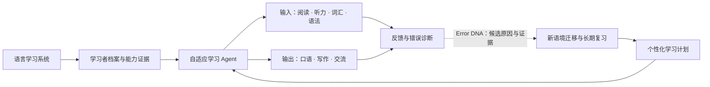
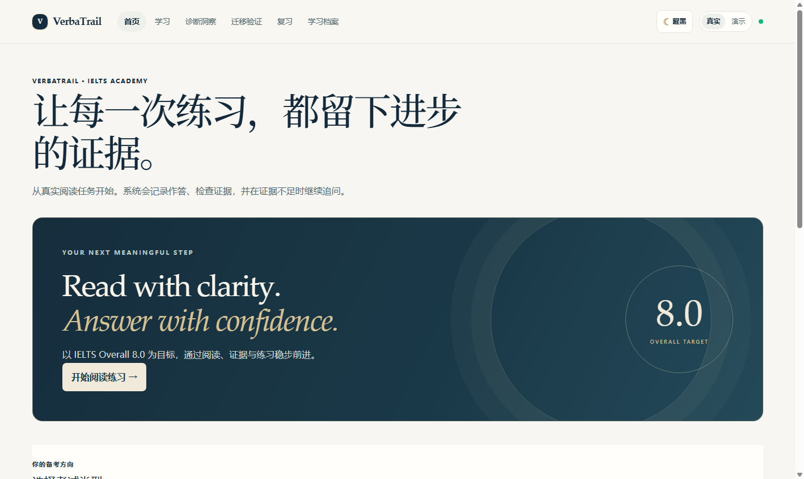
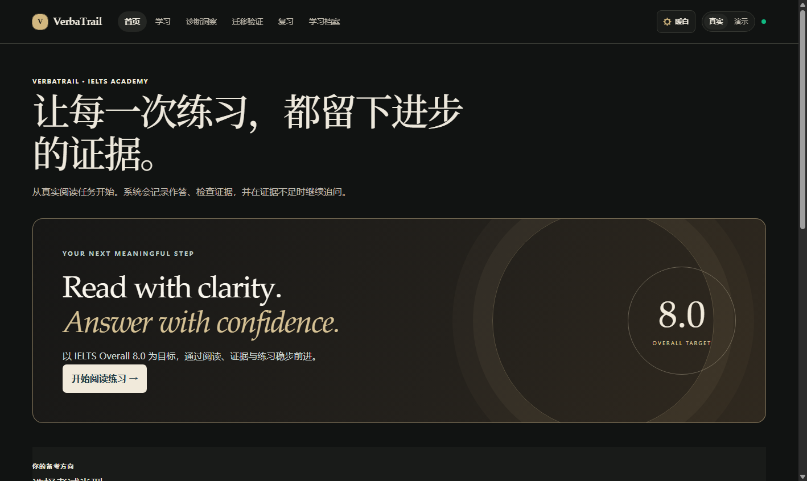
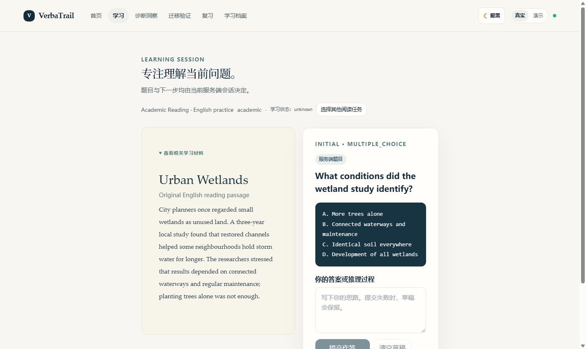
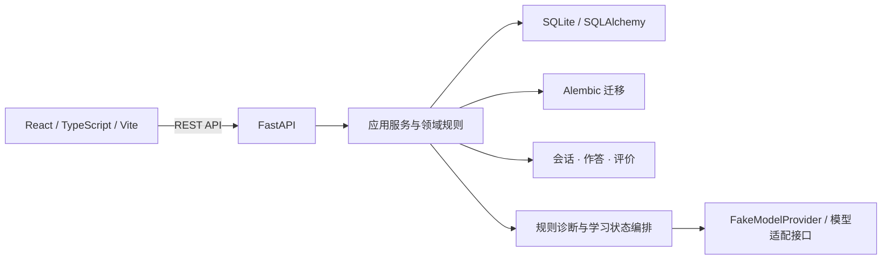

# VerbaTrail

**VerbaTrail —— 让语言学习真正因人而异。**

通过自适应学习、持续反馈与逐步发展的学习 Agent，帮助学习者从当前水平出发，建立理解、表达和真实运用语言的能力。

**首个目标场景：IELTS Overall Band 8.0。** 这是学习目标，不是当前水平、分数预测或结果保证。长期愿景是帮助学习者真正掌握一门语言，而不只提高考试答题正确率。

[English](README_EN.md) · [Reading 开发基线](https://github.com/KaoruMiyagawa/VerbaTrail/tree/feat/ielts-2b-reading-question-groups) · [Windows 快速启动](docs/development/QUICKSTART.md) · [当前架构](docs/architecture/CURRENT_ARCHITECTURE.md) · [产品方向](docs/product/IELTS_PRODUCT_DIRECTION.md) · [研发路线图](docs/development/ROADMAP.md)

> **当前状态** Learn V1.1 提供 Listening / Speaking / Reading / Writing 四项入口。Reading 接入 Academic / General Training 的现有练习，其他三项提供规划页。IELTS-2B.1 Phase 6.2 最终工程验收为 **PASS WITH LIMITATIONS**。原 Phase 6 **FAIL** 保留为历史记录。 [Phase 6.2 复验](docs/development/IELTS_2B1_PHASE6_2_ACCEPTANCE.md) · [原 Phase 6 报告](docs/development/IELTS_2B1_FINAL_ACCEPTANCE.md)

## 产品愿景

VerbaTrail 围绕学习者的目标、当前能力证据和可用时间，逐步安排适合的输入、练习、表达、反馈与复习。IELTS Overall 8.0 是首个明确目标场景；产品长期关注的是语言理解、交流和跨情境运用能力。

产品包含 **Learn / Discover / Adapt**。Learn 提供听、说、读、写四项技能，Discover 规划合法外部学习资源，Adapt 规划个性化学习决策。学习者目标、词汇、语法、Error DNA、迁移、复习、学习历史与能力评估属于跨技能共享能力。



**Error DNA 是反馈与错误诊断能力之一，不是整个产品。** 它帮助整理作答中观察到的错误、候选解释及验证证据；规则流程和 FakeModelProvider 不等于经过验证的真实 AI 语义诊断。一次作答、一次迁移通过或一次复习通过，都不能单独证明长期掌握。

## 当前功能状态

| 能力 | 状态与边界 |
| --- | --- |
| IELTS Reading | **有限范围已实现：** Academic 与 General Training 的原创阅读内容、TFNG 流程及 Matching Headings 题组作答和逐项评价。不是完整 Reading 题型覆盖。 |
| 反馈与 Error DNA | **部分实现：** 已有特定 Reading 路径的候选假设、证据、区分性追问和定向训练。状态由服务端规则流程支持；不代表真实模型教学效果或全语言学习者画像。 |
| 迁移与复习 | Matching Headings 独立迁移和首轮延迟复习有服务端记录。历史证据标记与状态协调已通过隔离复验。 |
| 学习历史与档案 | 展示服务端会话、知识状态、迁移与复习记录，以及历史证据有效性与重新验证入口。 |
| 双主题界面 | **已实现：** 一套 React 应用支持 Premium Academic 与 Noir & Champagne。 |
| Listening、Writing、Speaking | **规划中：** 尚未交付完整学习流程。 |
| Vocabulary、Grammar、理解与表达训练 | **规划中：** 尚无统一跨技能能力模型和完整训练体系。 |
| 学习者模型、个性化计划与自适应 Agent | **规划中：** 目前没有完整的初始能力评估或跨技能学习计划。 |
| IELTS 模考、UKVI、Life Skills、其他语言 | **尚未实现：** 属于后续方向；当前产品只实现部分英语 IELTS 阅读场景。 |
| 真实模型教学质量、官方评分、Band 预测 | **未验证 / 未实现：** 不承诺真实 AI 个性化效果、官方分数或 IELTS 8.0 结果。 |

### 主题与实际界面

下图保留早期 IELTS-1 隔离验收的首页和阅读界面。当前界面见 [Learn V1.1 浏览器截图](docs/development/learn-v1.1-browser-evidence/README.md)。

<table>
  <tr>
    <td><br><sub>Premium Academic · 首页</sub></td>
    <td><br><sub>Noir &amp; Champagne · 首页</sub></td>
  </tr>
  <tr>
    <td colspan="2"><br><sub>Academic Reading · 早期隔离浏览器验收</sub></td>
  </tr>
</table>

[IELTS-2B.1 Phase 6.2 最终复验](docs/development/IELTS_2B1_PHASE6_2_ACCEPTANCE.md) · [早期浏览器证据索引](docs/development/consolidation-browser-evidence/README.md) · [双主题视觉评审](docs/development/theme-visual-acceptance/VISUAL_REVIEW.md)

## 技术架构



当前后端管理学习会话、版本固定的阅读题组、结构化作答、评价快照、特定诊断流程、迁移和复习状态；React 通过 API Client 显示服务端状态。默认本地数据存储为 SQLite。统一学习者模型、跨技能策略规划和经过验证的实时模型 Agent 尚未实现。详情见[当前架构说明](docs/architecture/CURRENT_ARCHITECTURE.md)及[目标架构](docs/architecture/ARCHITECTURE.md)。

## Windows 本地启动

需要 Python 3.11+、Node.js、npm 和 Git。在仓库根目录执行：

```powershell
python -m venv .venv
.\.venv\Scripts\python -m pip install -r backend/requirements.txt
cd frontend
npm ci
cd ..
```

在第一个 PowerShell 窗口启动后端（数据库路径相对于 `backend/`）：

```powershell
$env:DATABASE_URL = 'sqlite:///./verbatrail-local.db'
$env:APP_NAME = 'VerbaTrail'
$env:MODEL_PROVIDER = 'fake'
$env:ALLOW_REMOTE_MODEL_CALLS = 'false'
cd backend
..\.venv\Scripts\python -m uvicorn app.main:app --host 127.0.0.1 --port 18000
```

在第二个窗口启动前端：

```powershell
cd frontend
npm run dev
```

访问 `http://127.0.0.1:15173`，API 文档位于 `http://127.0.0.1:18000/docs`。服务启动会迁移所配置的数据库；使用既有数据库前先备份并验证可恢复性。完整说明见[快速启动指南](docs/development/QUICKSTART.md)。这是本地开发配置，不是生产部署或多用户安全配置。

## 测试与成熟度

常用检查命令：

```powershell
cd backend
..\.venv\Scripts\python -m pytest
cd ../frontend
node --test tests/*.test.mjs
npm run typecheck
npm run build
```

IELTS-2B.1 Phase 6.2 的工程复验记录为后端 **166 项通过**、前端 **48 项通过**，TypeScript、生产构建、Alembic 单一 head、隔离 HTTP 和 Chrome 浏览器回归均通过。实际部署数据库协调、外部专家审校和生产发布评估仍待完成。 [Phase 6.2 验收范围与限制](docs/development/IELTS_2B1_PHASE6_2_ACCEPTANCE.md)

当前身份边界为本地单用户开发：`learner_id` 是筛选字段，不是认证。项目没有生产级账号认证或多租户隔离。项目也未声明开源许可证，请勿据此假定再分发权利。

## 文档与研发方向

- [产品方向](docs/product/IELTS_PRODUCT_DIRECTION.md)：以学习者为中心的语言学习愿景及能力规划。
- [产品需求概要](docs/product/PRD.md)：当前范围、能力状态与产品边界。
- [当前架构](docs/architecture/CURRENT_ARCHITECTURE.md) · [目标架构](docs/architecture/ARCHITECTURE.md)
- [研发路线图](docs/development/ROADMAP.md) · [Windows 快速启动](docs/development/QUICKSTART.md)
- [IELTS-2B.1 Phase 6.2 最终复验](docs/development/IELTS_2B1_PHASE6_2_ACCEPTANCE.md) · [历史 Phase 6 FAIL 报告](docs/development/IELTS_2B1_FINAL_ACCEPTANCE.md)

路线图从可信历史证据与状态重算开始，再逐步建立语言能力模型、初始评估和个性化学习规划；随后扩展其他技能、长期记忆与迁移，最后评估更多语言及智能教学能力。
