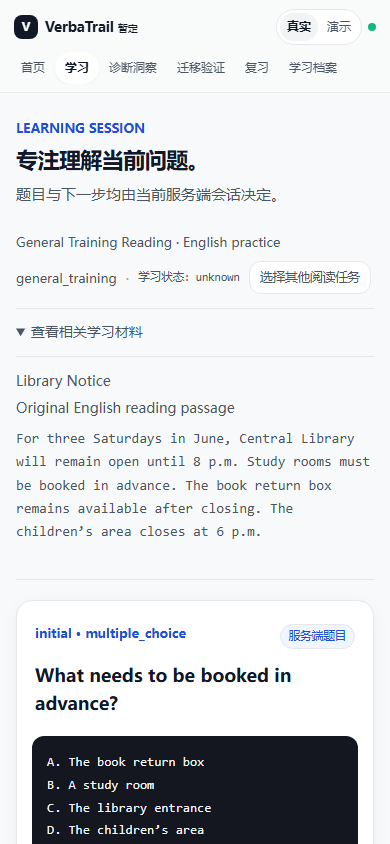
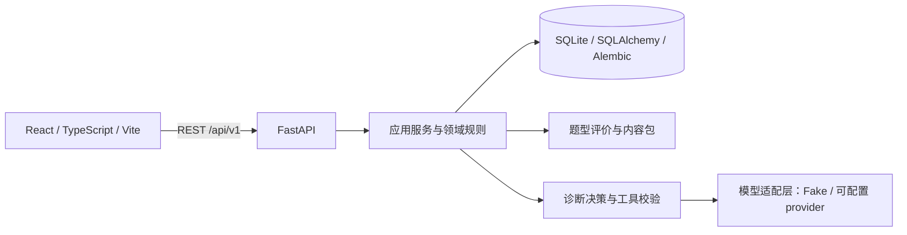

# UnlearnLoop

**从错误出发，用新情境中的证据验证理解。**

[English](README_EN.md) · [快速启动](docs/development/QUICKSTART.md) · [架构与状态](docs/architecture/CURRENT_ARCHITECTURE.md) · [验收报告](docs/development/IELTS_1_FINAL_BROWSER_ACCEPTANCE.md) · [参与贡献](CONTRIBUTING.md)

  

UnlearnLoop 是一个探索证据驱动学习的本地 MVP。普通刷题通常止步于对错；这里保留多个可能的错误原因，让后续追问和练习补充证据，再用未作答的新情境检查理解能否迁移。候选假设与启发式权重是待验证的工作判断，并非确定结论。

> **本页描述 `feat/ielts-pivot` 开发分支。** IELTS-1 已通过隔离环境下的阶段浏览器验收，尚未合并到 `main`，也不是生产发布验收。`main` 的实际状态请查看[默认分支 README](https://github.com/KaoruMiyagawa/UnlearnLoop/blob/main/README.md)。

## 学习如何推进


具体路径由服务端状态、评价结果和可用题目约束；不是每次作答都经过每一步。一次迁移通过不代表长期保持。

## 已实现与验证范围

| 能力 | 当前分支状态 |
| --- | --- |
| IELTS Reading | Academic / General Training 原创英语阅读、任务选择、目标设置及独立会话；Listening、Writing、Speaking 等仍为计划 |
| 学习闭环 | 服务端作答、诊断案例、候选假设与证据、追问、练习、独立迁移和知识状态；支持会话恢复 |
| 复习与历史 | 服务端安排复习、学习历史和知识状态展示；本次浏览器验收中的复习任务尚未到期 |
| 界面 | Real API 与 Demo 入口；指定阅读及答题页面已在 390px 视口验收 |
| 模型 | `FakeModelProvider` 用于离线模拟；远程 provider 适配和配置门控存在，真实模型质量、成本及可靠性未在本次验收中验证 |

IELTS-1 浏览器验收通过两种考试模式的指定流程；后端 80 项、前端 40 项测试、typecheck 和 production build 均通过。完整范围、证据与未验证项见[验收报告](docs/development/IELTS_1_FINAL_BROWSER_ACCEPTANCE.md)。这些结果不构成真实 AI 个性化诊断成功的证明。

<p align="center"></p>
<p align="center"><sub>隔离验收中的真实浏览器截图：General Training 阅读任务</sub></p>

## 架构



前端呈现服务端派发的题目和状态；后端管理事务、证据及状态转移。默认远程模型调用关闭。更多实现边界见[当前架构](docs/architecture/CURRENT_ARCHITECTURE.md)，原[架构设计](docs/architecture/ARCHITECTURE.md)保留为设计资料。

## 本地运行

需要 Python 3.11+、Node.js 和 npm。以下 PowerShell 示例使用新的 SQLite 文件；完整步骤见[快速启动](docs/development/QUICKSTART.md)。

```powershell
python -m venv .venv
.\.venv\Scripts\python -m pip install -r backend/requirements.txt
cd frontend
npm ci
cd ..
```

在一个终端中：

```powershell
$env:DATABASE_URL = 'sqlite:///./unlearnloop-local-new.db'
$env:MODEL_PROVIDER = 'fake'
$env:ALLOW_REMOTE_MODEL_CALLS = 'false'
cd backend
..\.venv\Scripts\python -m uvicorn app.main:app --host 127.0.0.1 --port 18000
```

另开终端运行 `cd frontend` 和 `npm run dev`，打开 `http://127.0.0.1:15173`；API 文档位于 `http://127.0.0.1:18000/docs`。开发模式启动会迁移数据库并导入内容；使用已有数据库前请先独立备份。仅在本机可信环境使用：`learner_id` 是筛选标识，不是身份认证。

## 验证与目录

```powershell
cd backend
..\.venv\Scripts\python -m pytest
cd ../frontend
node --test tests/*.test.mjs
npm run typecheck
npm run build
```

`backend/` 包含 API、领域与应用服务、评价器、内容包、迁移及测试；`frontend/` 包含 React 工作空间、API 客户端与测试；`docs/` 保存产品、架构、计划、基线归档和验收证据。浏览器验收未覆盖真实手机、读屏器、所有网络故障或真实模型；其他风险见 [MVP 审查](docs/development/MVP_FINAL_AUDIT.md)。

## 路线图

- **已完成阶段验收：** 本分支 IELTS-1 阅读闭环及指定浏览器场景。
- **集成前：** 审阅与主线差异；处理或明确接受数据库备份恢复、数据控制、依赖和单用户安全边界。
- **后续：** 扩充 IELTS 内容与其他技能；在明确授权、预算和隐私边界下评估真实模型；完善可访问性与质量门禁。见 [IELTS 实施计划](docs/development/IELTS_IMPLEMENTATION_PLAN.md)。

## 贡献与许可证

欢迎通过 issue 讨论问题和方向；提交前请阅读[贡献说明](CONTRIBUTING.md)。仓库目前**没有声明开源许可证**，不应假设已授予开源使用或再分发许可；许可证选择由维护者决定。
