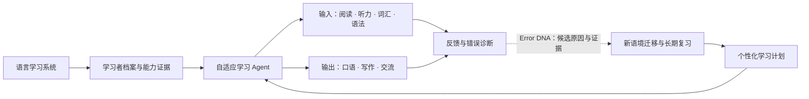
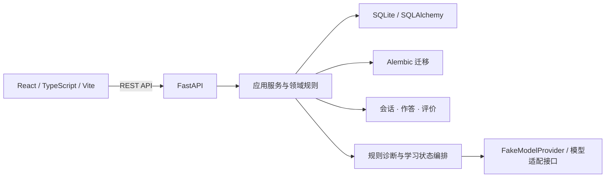

# VerbaTrail

**VerbaTrail —— 让语言学习真正因人而异。**

通过自适应学习、持续反馈与逐步发展的学习 Agent，帮助学习者从当前水平出发，建立理解、表达和真实运用语言的能力。

**首个目标场景：IELTS Overall Band 8.0。** 这是学习目标，不是当前水平、分数预测或结果保证。长期愿景是帮助学习者真正掌握一门语言，而不只提高考试答题正确率。

[English](README_EN.md) · [当前开发分支](https://github.com/KaoruMiyagawa/VerbaTrail/tree/feat/ielts-2b-reading-question-groups) · [Windows 快速启动](docs/development/QUICKSTART.md) · [当前架构](https://github.com/KaoruMiyagawa/VerbaTrail/blob/feat/ielts-2b-reading-question-groups/docs/architecture/CURRENT_ARCHITECTURE.md) · [产品方向](https://github.com/KaoruMiyagawa/VerbaTrail/blob/feat/ielts-2b-reading-question-groups/docs/product/IELTS_PRODUCT_DIRECTION.md) · [研发路线图](https://github.com/KaoruMiyagawa/VerbaTrail/blob/feat/ielts-2b-reading-question-groups/docs/development/ROADMAP.md)

> **当前状态：** IELTS Academic / General Training 的部分阅读学习、Matching Headings、错误反馈、针对性训练、独立迁移和首轮延迟复习已有实现。IELTS-2B.1 Phase 6 综合验收为 **FAIL**：已知旧版迁移/复习评分证据缺少有效性标记和学习状态重算机制。新内容版本已修正并阻止相关旧版本继续产生新验证，但历史记录的可信度处理尚未完成。当前开发分支的 Phase 4–6 修改仍在本地，未提交；该分支也未合并到 `main`。这不是生产发布。

## 产品愿景

VerbaTrail 围绕学习者的目标、当前能力证据和可用时间，逐步安排适合的输入、练习、表达、反馈与复习。IELTS Overall 8.0 是首个明确目标场景；产品长期关注的是语言理解、交流和跨情境运用能力。

目标产品关系如下。除下文标明已实现的 Reading 与学习流程外，统一学习者模型、个性化规划和跨技能 Agent 决策仍是规划能力。



**Error DNA 是反馈与错误诊断能力之一，不是整个产品。** 它帮助整理作答中观察到的错误、候选解释及验证证据；规则流程和 FakeModelProvider 不等于经过验证的真实 AI 语义诊断。一次作答、一次迁移通过或一次复习通过，都不能单独证明长期掌握。

## 当前功能状态

| 能力 | 状态与边界 |
| --- | --- |
| IELTS Reading | **有限范围已实现：** Academic 与 General Training 的原创阅读内容、TFNG 流程及 Matching Headings 题组作答和逐项评价。不是完整 Reading 题型覆盖。 |
| 反馈与 Error DNA | **部分实现：** 已有特定 Reading 路径的候选假设、证据、区分性追问和定向训练。状态由服务端规则流程支持；不代表真实模型教学效果或全语言学习者画像。 |
| 迁移与复习 | **首轮流程已实现，但有质量阻断：** Matching Headings 独立迁移和首轮延迟复习有服务端记录。Phase 6 发现旧版题组答案依据有误，历史证据有效性标记与状态重算尚未完成，详见最终验收报告（本地报告尚未提交）。 |
| 学习历史与档案 | **基础能力已实现：** 展示现有服务端会话、知识状态、迁移与复习记录；受上述历史证据问题影响，不能据此确认所有旧状态准确。 |
| 双主题界面 | **已实现：** 一套 React 应用支持 Premium Academic 与 Noir & Champagne。 |
| Listening、Writing、Speaking | **规划中：** 尚未交付完整学习流程。 |
| Vocabulary、Grammar、理解与表达训练 | **规划中：** 尚无统一跨技能能力模型和完整训练体系。 |
| 学习者模型、个性化计划与自适应 Agent | **规划中：** 目前没有完整的初始能力评估或跨技能学习计划。 |
| IELTS 模考、UKVI、Life Skills、其他语言 | **尚未实现：** 属于后续方向；当前产品只实现部分英语 IELTS 阅读场景。 |
| 真实模型教学质量、官方评分、Band 预测 | **未验证 / 未实现：** 不承诺真实 AI 个性化效果、官方分数或 IELTS 8.0 结果。 |

### 主题与实际界面

以下是项目浏览器验收中的真实截图，来自早期 IELTS-1 隔离验收，展示当时的首页和阅读界面，并不代表 IELTS-2B.1 Phase 6 通过，也不覆盖当前全部能力状态。

<table>
  <tr>
    <td><br><sub>Premium Academic · 首页</sub></td>
    <td><br><sub>Noir &amp; Champagne · 首页</sub></td>
  </tr>
  <tr>
    <td colspan="2"><br><sub>Academic Reading · 早期隔离浏览器验收</sub></td>
  </tr>
</table>

IELTS-2B.1 Phase 6 当前截图与验收边界（本地报告尚未提交） · [早期浏览器证据索引](https://github.com/KaoruMiyagawa/VerbaTrail/blob/feat/ielts-2b-reading-question-groups/docs/development/consolidation-browser-evidence/README.md) · [双主题视觉评审](https://github.com/KaoruMiyagawa/VerbaTrail/blob/feat/ielts-2b-reading-question-groups/docs/development/theme-visual-acceptance/VISUAL_REVIEW.md)

## 技术架构



当前后端管理学习会话、版本固定的阅读题组、结构化作答、评价快照、特定诊断流程、迁移和复习状态；React 通过 API Client 显示服务端状态。默认本地数据存储为 SQLite。统一学习者模型、跨技能策略规划和经过验证的实时模型 Agent 尚未实现。详情见[当前架构说明](https://github.com/KaoruMiyagawa/VerbaTrail/blob/feat/ielts-2b-reading-question-groups/docs/architecture/CURRENT_ARCHITECTURE.md)及[目标架构](https://github.com/KaoruMiyagawa/VerbaTrail/blob/feat/ielts-2b-reading-question-groups/docs/architecture/ARCHITECTURE.md)。

## Windows 本地启动

需要 Python 3.11+、Node.js、npm 和 Git。在仓库根目录执行：

```powershell
python -m venv .venv
.\.venv\Scripts\python -m pip install -r backend/requirements.txt
cd frontend
npm ci
cd ..
```

在第一个 PowerShell 窗口启动后端（数据库路径相对于 `backend/`）：

```powershell
$env:DATABASE_URL = 'sqlite:///./verbatrail-local.db'
$env:APP_NAME = 'VerbaTrail'
$env:MODEL_PROVIDER = 'fake'
$env:ALLOW_REMOTE_MODEL_CALLS = 'false'
cd backend
..\.venv\Scripts\python -m uvicorn app.main:app --host 127.0.0.1 --port 18000
```

在第二个窗口启动前端：

```powershell
cd frontend
npm run dev
```

访问 `http://127.0.0.1:15173`，API 文档位于 `http://127.0.0.1:18000/docs`。服务启动会迁移所配置的数据库；使用既有数据库前先备份并验证可恢复性。完整说明见[快速启动指南](docs/development/QUICKSTART.md)。这是本地开发配置，不是生产部署或多用户安全配置。

## 测试与成熟度

常用检查命令：

```powershell
cd backend
..\.venv\Scripts\python -m pytest
cd ../frontend
node --test tests/*.test.mjs
npm run typecheck
npm run build
```

IELTS-2B.1 Phase 6 本轮完整回归记录为后端 **159 passed**、前端 **47 passed**，TypeScript 检查、Production build、Alembic 单一 head、隔离 HTTP 与 Chrome 浏览器脚本均通过。**工程门禁通过不改变综合验收 FAIL 结论：旧版迁移/复习证据尚无可信度标记及重算机制。**测试使用规则和 FakeModelProvider；没有证明真实模型质量、外部专家审校、生产安全或完整 IELTS 覆盖。

当前身份边界为本地单用户开发：`learner_id` 是筛选字段，不是认证。项目没有生产级账号认证或多租户隔离。项目也未声明开源许可证，请勿据此假定再分发权利。

## 文档与研发方向

- [产品方向](https://github.com/KaoruMiyagawa/VerbaTrail/blob/feat/ielts-2b-reading-question-groups/docs/product/IELTS_PRODUCT_DIRECTION.md)：以学习者为中心的语言学习愿景及能力规划。
- [产品需求概要](https://github.com/KaoruMiyagawa/VerbaTrail/blob/feat/ielts-2b-reading-question-groups/docs/product/PRD.md)：当前范围、能力状态与产品边界。
- [当前架构](https://github.com/KaoruMiyagawa/VerbaTrail/blob/feat/ielts-2b-reading-question-groups/docs/architecture/CURRENT_ARCHITECTURE.md) · [目标架构](https://github.com/KaoruMiyagawa/VerbaTrail/blob/feat/ielts-2b-reading-question-groups/docs/architecture/ARCHITECTURE.md)
- [研发路线图](https://github.com/KaoruMiyagawa/VerbaTrail/blob/feat/ielts-2b-reading-question-groups/docs/development/ROADMAP.md) · [Windows 快速启动](docs/development/QUICKSTART.md)
- IELTS-2B.1 Phase 6 最终验收（本地报告尚未提交）：当前 FAIL 原因、修复、证据及未完成项。

路线图从可信历史证据与状态重算开始，再逐步建立语言能力模型、初始评估和个性化学习规划；随后扩展其他技能、长期记忆与迁移，最后评估更多语言及智能教学能力。
