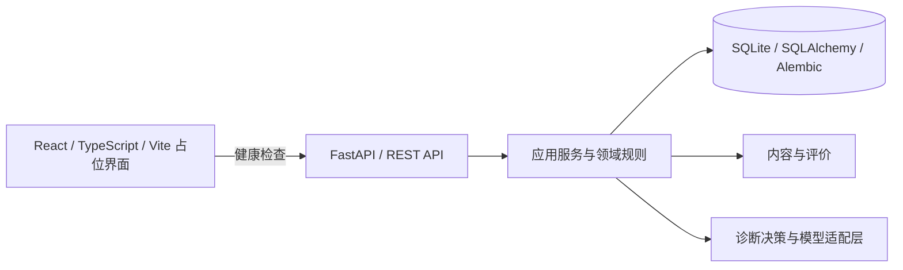

# UnlearnLoop

**从错误出发，用新情境中的证据验证理解。**

[English](README_EN.md) · [快速启动](docs/development/QUICKSTART.md) · [当前架构](docs/architecture/CURRENT_ARCHITECTURE.md) · [贡献说明](CONTRIBUTING.md)

  

UnlearnLoop 是一个探索证据驱动学习的项目。普通刷题通常止步于对错；UnlearnLoop 希望保留多个可能的错误原因，通过追问和练习收集证据，再用新情境检验学习是否迁移。候选假设与启发式权重是待验证的工作判断，不是确定结论。

## 当前状态：请区分两个分支

| 范围 | 真实状态 |
| --- | --- |
| **本页 `main`** | Stage 4 后端包含学习会话、作答、诊断、干预、迁移与档案相关 API、领域规则和持久化；前端是工作空间占位界面，除健康检查外未连接完整学习流程。数据库依赖存在已确认缺陷，见下方说明。 |
| **[IELTS 开发分支](https://github.com/KaoruMiyagawa/UnlearnLoop/tree/feat/ielts-pivot)** | Academic / General Training 阅读和学习界面已在隔离环境通过 IELTS-1 阶段验收，**尚未合并到 main**。详见[分支验收报告](https://github.com/KaoruMiyagawa/UnlearnLoop/blob/feat/ielts-pivot/docs/development/IELTS_1_FINAL_BROWSER_ACCEPTANCE.md)。 |
| **模型与部署** | 阶段验收使用 FakeModelProvider 离线模拟；真实 AI 个性化诊断与生产发布尚未验收。 |

<p align="center"></p>
<p align="center"><sub>真实浏览器截图：IELTS 开发分支，尚未合并到 main</sub></p>

## 学习流程


这是项目目标流程，具体执行受服务端状态、可用题目和当前分支实现约束；一次迁移通过不代表长期保持。`main` 的界面尚未接通此完整流程。

## 架构



后端管理学习状态与持久化；模型通过适配层调用，远程调用默认关闭。参见[当前架构与边界](docs/architecture/CURRENT_ARCHITECTURE.md)。

**已知主线缺陷：** `backend/app/api/v1/dependencies.py` 的 `get_session_factory` 引用了未导入的 `create_db_engine`，直接调用会引发 `NameError`，因此依赖该函数的数据库 API 不可视为可用。修复需另行审阅和集成；本次主页更新仅修改文档。

## 本地运行

需要 Python 3.11+、Node.js 与 npm。以下 PowerShell 示例选择独立数据库；启动会自动迁移并导入内容，使用已有数据库前请先备份。完整步骤见[快速启动](docs/development/QUICKSTART.md)。

```powershell
python -m venv .venv
.\.venv\Scripts\python -m pip install -r backend/requirements.txt
cd frontend
npm ci
cd ..
```

在后端终端：

```powershell
$env:DATABASE_URL = 'sqlite:///./unlearnloop-local-new.db'
$env:MODEL_PROVIDER = 'fake'
$env:ALLOW_REMOTE_MODEL_CALLS = 'false'
cd backend
..\.venv\Scripts\python -m uvicorn app.main:app --host 127.0.0.1 --port 18000
```

另开终端运行 `cd frontend`、`npm run dev`，打开 `http://127.0.0.1:15173`；API 文档为 `http://127.0.0.1:18000/docs`。仅在本机可信环境使用：`learner_id` 是筛选标识，不是身份认证。

## 测试与目录

```powershell
cd backend
..\.venv\Scripts\python -m pytest
cd ../frontend
npm run typecheck
npm run build
```

`backend/` 包含 API、领域和应用服务、持久化及测试；`frontend/` 包含界面和健康检查客户端；`docs/` 包含产品、架构、设计和路线图。IELTS 分支的 80 项后端、40 项前端及浏览器验收是**该分支**的结果，不代表 `main` 已包含这些功能。

## 路线图

- 审阅并安全集成开发分支的学习界面与 IELTS 阅读能力，不把分支验收等同于主线已交付。
- 在更广泛试用前处理备份与恢复、数据导出删除、依赖风险及身份授权边界。
- 扩充内容与技能，完善可访问性和质量门禁；在明确授权、预算和隐私边界下单独评估真实模型。早期规划见[开发路线图](docs/development/ROADMAP.md)。

## 贡献与许可证

欢迎通过 issue 讨论；提交前请阅读[贡献说明](CONTRIBUTING.md)。仓库目前**没有声明开源许可证**，不应假设已授予开源使用或再分发许可；许可证选择由维护者决定。
