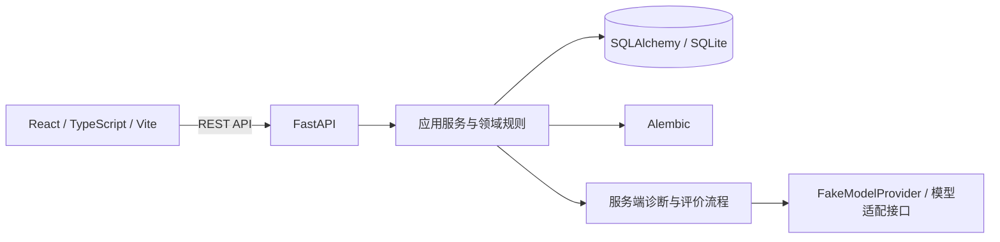

# VerbaTrail

**把错误变成线索，在新情境中验证理解。**

AI Agent 驱动的英语学习与 IELTS 备考平台，以 **IELTS Overall Band 8.0** 为学习目标。8.0 是备考目标，不是分数预测或保证。

[English](README_EN.md) · [最新应用分支](https://github.com/KaoruMiyagawa/VerbaTrail/tree/feat/verbatrail-consolidation) · [快速启动](docs/development/QUICKSTART.md) · [当前架构](docs/architecture/CURRENT_ARCHITECTURE.md) · [路线图](docs/development/ROADMAP.md)

> GitHub 默认分支 `main` 目前还没有最新 IELTS 应用版本。最新整合成果在 [`feat/verbatrail-consolidation`](https://github.com/KaoruMiyagawa/VerbaTrail/tree/feat/verbatrail-consolidation)；尚未合并到 `main`，也不是生产发布。

## 产品方向

VerbaTrail 希望帮助学习者理解错误背后的原因，而非只累计题量。我们将 **Error DNA** 作为产品方向：持续整理可验证的错误线索，形成能被新问题检验的学习假设。

当前代码已实现这条方向的基础环节：后端记录竞争假设与证据，根据会话状态安排追问和针对性练习，并通过独立新题验证迁移；服务端也管理知识状态与间隔复习计划。**目前没有经过校准的 Error DNA 学习画像、官方 IELTS 评分或真实模型诊断质量保证。**长期复习安排已实现，长期记忆效果尚未经过学习研究验证。


实际流程由服务端状态和可用任务决定；并非每次作答都会执行全部步骤。

## 功能状态

| 能力 | 当前状态 |
| --- | --- |
| Reading | **已实现：** IELTS Academic 与 General Training 阅读模式、原创英文材料、服务端任务选择与作答流程。 |
| 诊断与练习 | **基础流程已实现：** 服务端 Agent 工作流、竞争假设、证据、追问、定向练习及迁移验证；FakeModelProvider 只模拟模型响应。 |
| Review 与学习档案 | **已实现：** 真实 ReviewItem、到期信息、历史、知识状态、迁移/延迟复习证据及未知状态展示。 |
| 双主题界面 | **已实现：** 单套 React 应用提供 Premium Academic 与 Noir & Champagne；偏好本地保存，阅读文章保持暖象牙白底色。 |
| Listening、Writing、Speaking | **规划中：** 当前不是完整四科备考产品。 |
| Vocabulary、Grammar、Mock Tests | **规划中：** 暂无完整学习流程。 |
| UKVI、Life Skills | **规划中：** 尚未作为可用考试流程交付。 |
| 真实模型诊断与分数预测 | **未验证：** 不宣称真实 AI 个性化质量、官方评分或 Band 预测能力。 |

### 验收截图

以下截图来自隔离 Headless Chrome 浏览器验收，不是设计稿。阅读工作流使用 FakeModelProvider，不代表真实模型效果。

<table>
  <tr>
    <td><br><sub>Premium Academic · 首页</sub></td>
    <td><br><sub>Noir &amp; Champagne · 首页</sub></td>
  </tr>
  <tr>
    <td colspan="2"><br><sub>Academic Reading · 文章与服务端题目</sub></td>
  </tr>
</table>

[浏览器验收记录与手机截图](docs/development/consolidation-browser-evidence/README.md) · [IELTS-1 双主题视觉验收](docs/development/theme-visual-acceptance/VISUAL_REVIEW.md)

## 技术架构



前端呈现服务端任务和状态；后端负责会话、作答、幂等恢复、诊断、迁移验证、知识状态与复习计划。SQLite 是本地开发默认配置，Alembic 历史迁移保留在仓库中。架构边界见[当前架构说明](docs/architecture/CURRENT_ARCHITECTURE.md)。

## 本地启动

需要 Python 3.11+、Node.js、npm 和 Git。以下命令从仓库根目录开始：

```powershell
python -m venv .venv
.\.venv\Scripts\python -m pip install -r backend/requirements.txt
cd frontend
npm ci
cd ..
```

在第一个终端启动后端（数据库路径相对于 `backend/`）：

```powershell
$env:DATABASE_URL = 'sqlite:///./verbatrail-local.db'
$env:APP_NAME = 'VerbaTrail'
$env:MODEL_PROVIDER = 'fake'
$env:ALLOW_REMOTE_MODEL_CALLS = 'false'
cd backend
..\.venv\Scripts\python -m uvicorn app.main:app --host 127.0.0.1 --port 18000
```

在第二个终端启动前端：

```powershell
cd frontend
npm run dev
```

打开 `http://127.0.0.1:15173`；API 文档位于 `http://127.0.0.1:18000/docs`。开发启动会对所配置数据库运行迁移；使用已有数据库前应先建立并验证备份。详细端口与数据说明见[快速启动指南](docs/development/QUICKSTART.md)。

## 测试

```powershell
cd backend
..\.venv\Scripts\python -m pytest
cd ../frontend
node --test tests/*.test.mjs
npm run typecheck
npm run build
```

当前基线：后端 80 项、前端 40 项测试通过。测试使用固定样例和 FakeModelProvider，不调用付费模型；这些结果不验证真实模型的个性化诊断能力。

## 项目结构

```text
backend/               FastAPI、应用/领域服务、内容包、Alembic 迁移与 pytest
frontend/              React 页面、主题令牌、API Client 与前端流程测试
docs/architecture/     当前系统架构
docs/design/           双主题原型、设计系统与历史方案
docs/development/      快速启动、阶段验收、浏览器证据与路线图
docs/archive/          被新方案取代但仍有参考价值的资料
```

## 路线图

- **当前开发：** 整合并稳定 IELTS Academic / General Training Reading、Review、学习档案与双主题体验。
- **后续规划：** 扩展 Listening、Writing、Speaking、Vocabulary、Grammar、Mock Tests、UKVI 和 Life Skills。
- **独立质量门禁：** 真实模型、评分与 Band 估计须另行验证隐私、预算、可靠性和准确度。

完整状态见[开发路线图](docs/development/ROADMAP.md)。欢迎先通过 issue 讨论改进，并遵循[贡献指南](CONTRIBUTING.md)。目前未声明开源许可证，请勿假定可以自由再分发。