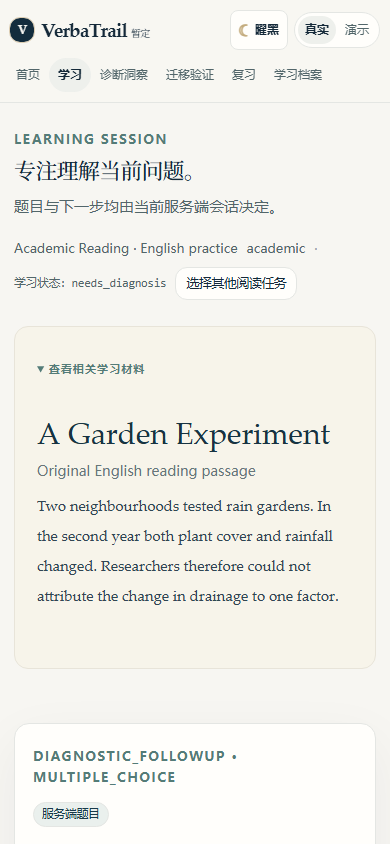
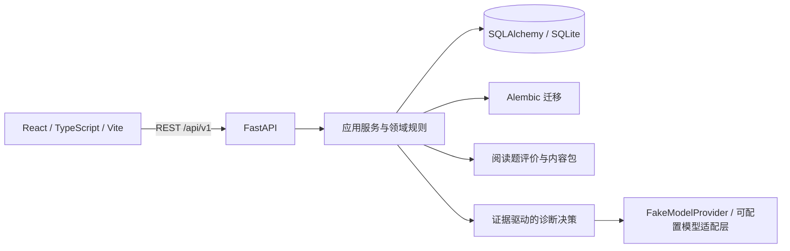

# VerbaTrail

**从错误出发，在新情境中验证理解。**

[English](README_EN.md) · [快速启动](docs/development/QUICKSTART.md) · [当前架构](docs/architecture/CURRENT_ARCHITECTURE.md) · [开发路线图](docs/development/ROADMAP.md) · [参与贡献](CONTRIBUTING.md)

  

VerbaTrail 是面向英语学习与 IELTS 备考的自适应学习软件。普通刷题工具通常在显示正误后结束；VerbaTrail 还会保留可能的错误原因，继续收集证据，再用针对性练习和独立新题检查理解是否迁移。

系统维护的是可修正的学习假设和服务端状态，不把一次答对包装成掌握，也不以未经校准的分数制造确定感。

> **当前工作树：** 本地 `feat/verbatrail-consolidation` 整合分支，以已通过 IELTS-1 阶段验收的 `feat/ielts-pivot` 为代码基线。整合尚未 Push 或合并到 GitHub 的 `main`。远程仓库地址暂时仍为 `KaoruMiyagawa/UnlearnLoop`。

## 学习闭环


具体路径由服务端的会话状态、评价结果和可用题目决定；不是每次作答都会经过所有环节。

## 当前实现状态

| 能力 | 状态 |
| --- | --- |
| IELTS Reading | Academic 与 General Training 模式、原创英文阅读材料、服务端任务选择、作答与独立学习会话已实现并通过 IELTS-1 阶段验收。 |
| 学习引擎 | 会话、答案、诊断案例、候选原因、证据、追问、定向练习、独立迁移验证和知识状态更新由后端业务流程管理。 |
| 复习与档案 | 服务端 ReviewItem、到期信息、历史记录、知识状态、迁移/延迟复习证据和未知状态展示已实现。 |
| UI | 单一 React 应用支持 Premium Academic 与 Noir & Champagne 两套主题；阅读区在两种主题下均保留暖象牙白底色。偏好保存在浏览器本地。 |
| Demo / Real | Demo 是隔离演示界面；Real 读取后端 API。Real 代表真实后端数据流，不表示请求了真实大模型。 |
| Agent / 模型 | 后端 Agent 决策流程和 FakeModelProvider 可用于离线模拟。真实模型个性化诊断质量、成本、稳定性及生产部署尚未通过本项目验收。 |
| 其他技能 | Listening、Writing、Speaking、Vocabulary、Grammar、Mock Tests、UKVI 和 Life Skills 仍处于规划或建设中，不应视为已交付功能。 |

IELTS-1 阶段验收记录为后端 80 项测试、前端 40 项测试、typecheck、production build 及隔离 Headless Chrome 浏览器流程通过。该结论不是生产环境发布验收，也不证明 FakeModelProvider 具备真实 AI 个性化诊断能力。主题 UI 另有[浏览器视觉验收记录](docs/development/theme-visual-acceptance/VISUAL_REVIEW.md)。

<p align="center"></p>
<p align="center"><sub>隔离浏览器验收截图；诊断流程使用 FakeModelProvider。</sub></p>

## 架构



前端呈现服务端派发的任务和状态。后端负责写入事务、幂等恢复、评价、诊断决策、迁移验证和复习安排。Alembic `0001`–`0004` 迁移与历史内容均保留。完整边界见[当前架构说明](docs/architecture/CURRENT_ARCHITECTURE.md)。

## 本地安装与启动

需要 Python 3.11+、Node.js、npm 和 Git。Windows PowerShell 示例从仓库根目录运行：

```powershell
python -m venv .venv
.\.venv\Scripts\python -m pip install -r backend/requirements.txt
cd frontend
npm ci
cd ..
```

在第一个终端启动后端：

```powershell
$env:DATABASE_URL = 'sqlite:///./verbatrail-local.db'
$env:APP_NAME = 'VerbaTrail'
$env:MODEL_PROVIDER = 'fake'
$env:ALLOW_REMOTE_MODEL_CALLS = 'false'
cd backend
..\.venv\Scripts\python -m uvicorn app.main:app --host 127.0.0.1 --port 18000
```

`DATABASE_URL` 路径相对于 `backend/`。首次开发启动会执行 Alembic 迁移并导入内容；对任何已有数据库先做可恢复备份。这个示例使用新的本地数据库，不会选用归档的 `unlearnloop.db`。

在第二个终端启动前端：

```powershell
cd frontend
npm run dev
```

打开 `http://127.0.0.1:15173`，API 文档在 `http://127.0.0.1:18000/docs`。也可在 Windows 使用 `./start-verbatrail.ps1`。服务默认仅监听本机；`learner_id` 是筛选标识，不提供身份认证或多用户安全边界。

详细设置、停止服务、数据库注意事项和隔离端口说明见[快速启动指南](docs/development/QUICKSTART.md)。

## 测试与工程检查

```powershell
cd backend
..\.venv\Scripts\python -m pytest
cd ../frontend
node --test tests/*.test.mjs
npm run typecheck
npm run build
git diff --check
```

后端测试使用 pytest 临时 SQLite；前端流程测试使用 Node.js 内置测试运行器。自动化测试使用固定样例与 FakeModelProvider，不调用付费模型。真实浏览器验收证据和范围限制存于 `docs/development/`。

## 项目结构

```text
backend/               FastAPI、应用/领域服务、内容包、Alembic 迁移、pytest 测试
frontend/              React 工作区、主题令牌、API Client、前端流程测试
docs/architecture/     当前架构与原目标设计
docs/design/           双主题参考、已采纳设计及归档原型
docs/development/      快速启动、路线图、阶段验收与视觉证据
docs/archive/          尚有参考价值但已被新计划替代的规划稿
```

## 设计资料

选定的产品界面方向是清晰、克制的学术阅读体验，提供 Premium Academic 和 Noir & Champagne 两套主题。双主题 HTML 原型、handoff 和参考图位于 [`docs/design/verbatrail-dual-theme-reference/`](docs/design/verbatrail-dual-theme-reference/)。Argon 的 Focus 原型及 Oxford、Nordic、Nocturne 方案作为历史设计材料保存在 `docs/design/archived/`，未采用方案不代表当前产品功能。

## 路线图

- **已完成阶段验收：** Stage 3/4 核心诊断与 API、Stage 5 学习工作区/复习/档案、IELTS-1 Academic 与 General Training 阅读闭环、双主题 UI。
- **整合后待处理：** 将本地整合分支审阅后安全纳入正式远程主线；完善备份恢复与数据控制，并完成干净环境安装回归。
- **规划中：** 扩展 Listening、Writing、Speaking、Vocabulary、Grammar、Mock Tests、UKVI 与 Life Skills；真实模型、评分和估分须单独经过隐私、预算与质量门禁。

路线图以代码与测试为准，不把规划文档中的未来阶段标成已实现。详见[开发路线图](docs/development/ROADMAP.md)及[IELTS 实施计划](docs/development/IELTS_IMPLEMENTATION_PLAN.md)。

## 贡献与许可证

欢迎先通过 issue 讨论缺陷与建议，开发提交请遵守[贡献指南](CONTRIBUTING.md)，并为状态变化补充测试。目前仓库没有声明开源许可证；请勿假定可以自由使用或再分发。
