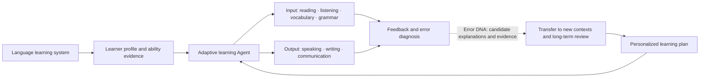
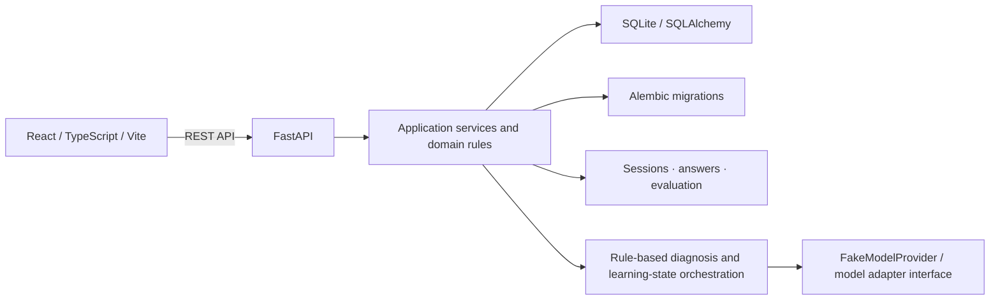

# VerbaTrail

**VerbaTrail — Learn a language. Make it yours.**

An adaptive language learning system designed to help learners build understanding, communication skills, and lasting proficiency through personalized practice and evidence-based feedback.

**First milestone: IELTS Overall Band 8.0.** This is a learning goal, not a statement of current ability, a score prediction, or a guarantee. The long-term vision is to help people truly learn a language, beyond getting more test questions right.

[简体中文](README.md) · [Current development branch](https://github.com/KaoruMiyagawa/VerbaTrail/tree/feat/ielts-2b-reading-question-groups) · [Windows quick start](docs/development/QUICKSTART.md) · [Current architecture](docs/architecture/CURRENT_ARCHITECTURE.md) · [Product direction](docs/product/IELTS_PRODUCT_DIRECTION.md) · [Roadmap](docs/development/ROADMAP.md)

> **Current status:** Limited IELTS Academic and General Training reading flows, Matching Headings, feedback, targeted practice, independent transfer, and a first delayed-review cycle are implemented. The IELTS-2B.1 Phase 6 comprehensive acceptance result is **FAIL**: legacy transfer/review scoring evidence has no validity marker or learning-state recalculation path. New content versions were corrected and affected legacy versions are blocked from creating further verification evidence, but existing records still need a trust review. Phase 4–6 work on the current development branch remains local and uncommitted; this branch has not been merged into `main`. This is not a production release.

## Product vision

VerbaTrail aims to adapt practice to a learner’s goals, evidence about their current abilities, and available time. It will combine useful input, practice, communication, feedback, and review. IELTS Overall Band 8.0 is the first concrete target scenario; the broader goal is language understanding, communication, and use across contexts.

The product relationship is planned as follows. Except for the implemented Reading and learning flows listed below, a unified learner model, personalized planner, and cross-skill Agent strategy remain planned capabilities.



**Error DNA is one feedback and diagnosis capability, not the whole product.** It organizes observed answer patterns, candidate explanations, and evidence that may verify them. Rule-based flows and FakeModelProvider do not establish real AI semantic diagnosis. A single answer, transfer pass, or review pass cannot by itself prove lasting mastery.

## Capability status

| Capability | Status and limits |
| --- | --- |
| IELTS Reading | **Implemented in a limited scope:** original Academic and General Training materials, TFNG flows, and Matching Headings group answers with item-level evaluation. This is not full Reading question-type coverage. |
| Feedback and Error DNA | **Partially implemented:** candidate hypotheses, evidence, discriminating follow-up, and targeted practice for specific Reading paths. These are supported by server-side rules; they are not validated real-model teaching or a language-wide learner profile. |
| Transfer and review | **First cycle implemented with a quality blocker:** Matching Headings independent transfer and first delayed review have server records. Phase 6 found incorrect answer evidence in legacy content versions; validity labeling and state recalculation for historical evidence remain unfinished. See the [final acceptance report](docs/development/IELTS_2B1_FINAL_ACCEPTANCE.md). |
| Learning history and profile | **Basic capability implemented:** displays existing server-side sessions, knowledge states, transfer and review records. The legacy evidence issue means not every old state can be treated as accurate. |
| Dual-theme interface | **Implemented:** one React app supports Premium Academic and Noir & Champagne. |
| Listening, Writing, Speaking | **Planned:** complete learning flows have not been delivered. |
| Vocabulary, Grammar, comprehension and expression practice | **Planned:** there is no unified cross-skill ability model or complete training system yet. |
| Learner model, personalized plan, adaptive Agent | **Planned:** a complete initial ability assessment and cross-skill plan do not exist yet. |
| IELTS mock tests, UKVI, Life Skills, other languages | **Not implemented:** future directions; the current product covers only limited English IELTS Reading scenarios. |
| Real-model teaching quality, official scoring, band prediction | **Unvalidated / not implemented:** no claim of real AI personalization, official scores, or an IELTS 8.0 outcome. |

### Themes and product captures

These are genuine browser captures from an earlier isolated IELTS-1 acceptance run. They show the home and Reading interface at that time; they do not imply that IELTS-2B.1 Phase 6 passed or that all current capabilities are complete.

<table>
  <tr>
    <td><br><sub>Premium Academic · Home</sub></td>
    <td><br><sub>Noir &amp; Champagne · Home</sub></td>
  </tr>
  <tr>
    <td colspan="2"><br><sub>Academic Reading · earlier isolated browser acceptance</sub></td>
  </tr>
</table>

[IELTS-2B.1 Phase 6 captures and acceptance limits](docs/development/IELTS_2B1_FINAL_ACCEPTANCE.md) · [Earlier browser evidence index](docs/development/consolidation-browser-evidence/README.md) · [Dual-theme visual review](docs/development/theme-visual-acceptance/VISUAL_REVIEW.md)

## Architecture



The current backend manages learning sessions, version-pinned reading groups, structured answers, evaluation snapshots, specific diagnostic flows, transfer, and review states. React renders server-provided state through an API client. SQLite is the default local store. A unified learner model, cross-skill planning, and a validated live-model Agent are not implemented. See the [current architecture](docs/architecture/CURRENT_ARCHITECTURE.md) and [target architecture](docs/architecture/ARCHITECTURE.md).

## Run locally on Windows

Requirements: Python 3.11+, Node.js, npm, and Git. From the repository root:

```powershell
python -m venv .venv
.\.venv\Scripts\python -m pip install -r backend/requirements.txt
cd frontend
npm ci
cd ..
```

Start the backend in a PowerShell window (`DATABASE_URL` is relative to `backend/`):

```powershell
$env:DATABASE_URL = 'sqlite:///./verbatrail-local.db'
$env:APP_NAME = 'VerbaTrail'
$env:MODEL_PROVIDER = 'fake'
$env:ALLOW_REMOTE_MODEL_CALLS = 'false'
cd backend
..\.venv\Scripts\python -m uvicorn app.main:app --host 127.0.0.1 --port 18000
```

Start the frontend in a second window:

```powershell
cd frontend
npm run dev
```

Open `http://127.0.0.1:15173`; API documentation is at `http://127.0.0.1:18000/docs`. Startup migrates the configured database. Back up and verify recoverability before using an existing database. See the [quick-start guide](docs/development/QUICKSTART.md) for details. This is a local development setup, not a production or multi-user security configuration.

## Tests and project maturity

Common checks:

```powershell
cd backend
..\.venv\Scripts\python -m pytest
cd ../frontend
node --test tests/*.test.mjs
npm run typecheck
npm run build
```

The IELTS-2B.1 Phase 6 regression run recorded **159 backend tests passed** and **47 frontend tests passed**; TypeScript checks, production build, a single Alembic head, isolated HTTP flows, and Chrome browser scripts also passed. **Passing engineering checks do not change the comprehensive acceptance result of FAIL:** historical transfer/review evidence still lacks a trust marker and recalculation path. Tests use rules and FakeModelProvider; they do not validate real-model quality, external expert review, production security, or complete IELTS coverage.

The current trust boundary is local, single-user development: `learner_id` is a filter, not authentication. The project does not provide production-grade account authentication or tenant isolation. No open-source license is declared; redistribution rights should not be assumed.

## Product and development documents

- [Product direction](docs/product/IELTS_PRODUCT_DIRECTION.md): learner-centered language-learning vision and capability plan.
- [Product requirements](docs/product/PRD.md): current scope, capability status, and product boundaries.
- [Current architecture](docs/architecture/CURRENT_ARCHITECTURE.md) · [Target architecture](docs/architecture/ARCHITECTURE.md)
- [Development roadmap](docs/development/ROADMAP.md) · [Windows quick start](docs/development/QUICKSTART.md)
- [IELTS-2B.1 Phase 6 final acceptance](docs/development/IELTS_2B1_FINAL_ACCEPTANCE.md): current FAIL reason, fixes, evidence, and outstanding work.

The roadmap starts with trust labels and recalculation for historical evidence, then builds a language ability model, initial assessment, and personalized planning. It next expands across skills, long-term memory and transfer, before evaluating additional languages and more capable teaching systems.
