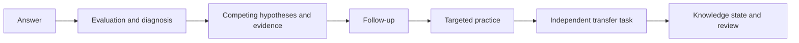

# UnlearnLoop

**Start with mistakes. Verify understanding in a new context.**

[中文](README.md) · [Quick start](docs/development/QUICKSTART.md) · [Architecture](docs/architecture/CURRENT_ARCHITECTURE.md) · [Contributing](CONTRIBUTING.md)

  

UnlearnLoop explores evidence-driven learning: retain competing explanations for an error, gather evidence through follow-up and practice, and check understanding in a new context. Hypotheses and heuristic weights are provisional, not certain diagnoses.

## Current status: distinguish the branches

| Scope | Actual state |
| --- | --- |
| **This `main` branch** | Stage 4 backend APIs, domain rules and persistence cover sessions, attempts, diagnosis, interventions, transfer and profile. The frontend is a placeholder with a health check, not a connected end-to-end learning UI. A confirmed database dependency defect is described below. |
| **[IELTS development branch](https://github.com/KaoruMiyagawa/UnlearnLoop/tree/feat/ielts-pivot)** | Academic and General Training reading and the learning interface passed the specified isolated IELTS-1 acceptance; they are **not merged into main**. See its [acceptance report](https://github.com/KaoruMiyagawa/UnlearnLoop/blob/feat/ielts-pivot/docs/development/IELTS_1_FINAL_BROWSER_ACCEPTANCE.md). |
| **Model and deployment** | Acceptance used an offline FakeModelProvider; real AI personalization and production release have not been validated. |

<p align="center"></p>
<p align="center"><sub>Actual browser capture from the IELTS branch, not the current main interface</sub></p>

## Learning loop



This is the intended flow, subject to server state, available tasks and branch implementation. A transfer pass does not prove long-term retention. The main-branch UI does not yet connect the complete flow.

## Architecture and local setup

React, TypeScript and Vite provide the placeholder frontend; FastAPI coordinates domain and application services, with SQLite, SQLAlchemy and Alembic for persistence and a model provider abstraction. See [current architecture](docs/architecture/CURRENT_ARCHITECTURE.md).

**Known main-branch defect:** `get_session_factory` in `backend/app/api/v1/dependencies.py` refers to `create_db_engine` without importing it. Direct invocation raises `NameError`, so database APIs using that dependency cannot be considered operational. A fix requires separate review and integration; this homepage update changes documentation only.

Requirements: Python 3.11+, Node.js and npm. On Windows PowerShell:

```powershell
python -m venv .venv
.\.venv\Scripts\python -m pip install -r backend/requirements.txt
cd frontend
npm ci
cd ..
```

In a backend terminal:

```powershell
$env:DATABASE_URL = 'sqlite:///./unlearnloop-local-new.db'
$env:MODEL_PROVIDER = 'fake'
$env:ALLOW_REMOTE_MODEL_CALLS = 'false'
cd backend
..\.venv\Scripts\python -m uvicorn app.main:app --host 127.0.0.1 --port 18000
```

In another terminal, run `cd frontend` and `npm run dev`, then visit `http://127.0.0.1:15173`. API docs: `http://127.0.0.1:18000/docs`. Development startup migrates the configured database and seeds content; use a new file and back up existing data. See the [quick start](docs/development/QUICKSTART.md). This is a trusted local MVP; `learner_id` is not authentication.

## Tests and layout

```powershell
cd backend
..\.venv\Scripts\python -m pytest
cd ../frontend
npm run typecheck
npm run build
```

`backend/` holds the API, services, persistence and tests; `frontend/` holds the placeholder interface and health client; `docs/` contains product, architecture, design and roadmap documents. The IELTS branch's 80 backend tests, 40 frontend tests and browser acceptance describe that branch, not features already on main.

## Roadmap and contributing

Review integration of the learning interface and IELTS branch; address backup and restore, data export/deletion, dependency risks and authorization before broader use. Future work includes more content and skills, accessibility, quality automation and real-model evaluation with clear consent, budget and privacy boundaries. See the [roadmap](docs/development/ROADMAP.md).

Issues and contributions are welcome; see [CONTRIBUTING.md](CONTRIBUTING.md). **No open-source license is currently declared.** Do not assume permission to reuse or redistribute; the maintainer must choose a license.
