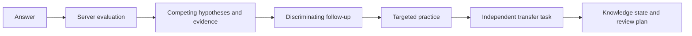
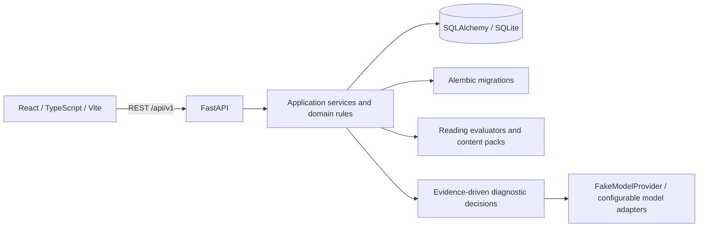

# VerbaTrail

**Start with mistakes. Verify understanding in a new context.**

[中文](README.md) · [Quick start](docs/development/QUICKSTART.md) · [Architecture](docs/architecture/CURRENT_ARCHITECTURE.md) · [Roadmap](docs/development/ROADMAP.md) · [Contributing](CONTRIBUTING.md)

  

VerbaTrail is an adaptive English learning and IELTS preparation application. Typical practice tools stop at right or wrong. VerbaTrail keeps plausible explanations for errors, gathers more evidence, then uses targeted practice and an independent task to check whether understanding transfers.

The system stores revisable learning hypotheses and server-owned state. One correct answer is not presented as mastery, and uncalibrated scores are not presented as certainty.

> **This workspace:** local branch `feat/verbatrail-consolidation`, based on the IELTS-1 accepted `feat/ielts-pivot` code. This consolidation has not been pushed or merged into GitHub `main`. The remote repository URL remains `KaoruMiyagawa/UnlearnLoop` for now.

## Learning loop



The server selects valid transitions from session state, evaluation results and available questions. A session does not necessarily pass through every step.

## Implemented status

| Area | Status |
| --- | --- |
| IELTS Reading | Academic and General Training modes, original English reading material, server-selected tasks, answers and separate learning sessions passed IELTS-1 stage acceptance. |
| Learning engine | The backend manages sessions, attempts, diagnostic cases, competing hypotheses, evidence, follow-up, targeted practice, independent transfer and knowledge-state updates. |
| Review and profile | Server-side ReviewItems, due information, history, knowledge states, transfer/delayed-review evidence and unknown states are displayed. |
| UI | One React application provides Premium Academic and Noir & Champagne themes. Reading passages keep a warm ivory surface in both themes; preference is stored locally. |
| Demo / Real | Demo is an isolated presentation mode; Real uses the backend API. Real means the real backend data flow, not a real large language model. |
| Agent / models | The backend Agent flow and FakeModelProvider support offline simulation. Real-model personalization quality, cost, reliability and production deployment have not passed validation. |
| Other skills | Listening, Writing, Speaking, Vocabulary, Grammar, Mock Tests, UKVI and Life Skills remain planned or in progress, not delivered features. |

The IELTS-1 stage record reports 80 backend tests, 40 frontend tests, typecheck, production build and the specified isolated Headless Chrome flows passing. It is not a production release acceptance and does not prove real AI personalization. See the [dual-theme browser review](docs/development/theme-visual-acceptance/VISUAL_REVIEW.md) for UI evidence and limitations.

<p align="center"></p>
<p align="center"><sub>Isolated browser capture; the diagnostic flow uses FakeModelProvider.</sub></p>

## Architecture



The frontend renders server-assigned tasks and states. The backend owns transactions, idempotent recovery, evaluation, diagnostic decisions, transfer checks and review scheduling. Alembic migrations `0001`–`0004` and historical content are retained. See [current architecture](docs/architecture/CURRENT_ARCHITECTURE.md).

## Install and run locally

Requirements: Python 3.11+, Node.js, npm and Git. The PowerShell commands below start from the repository root:

```powershell
python -m venv .venv
.\.venv\Scripts\python -m pip install -r backend/requirements.txt
cd frontend
npm ci
cd ..
```

Start the backend in one terminal:

```powershell
$env:DATABASE_URL = 'sqlite:///./verbatrail-local.db'
$env:APP_NAME = 'VerbaTrail'
$env:MODEL_PROVIDER = 'fake'
$env:ALLOW_REMOTE_MODEL_CALLS = 'false'
cd backend
..\.venv\Scripts\python -m uvicorn app.main:app --host 127.0.0.1 --port 18000
```

`DATABASE_URL` is relative to `backend/`. First development startup runs Alembic migrations and imports content. Back up any existing database and verify that the backup is recoverable first. This example uses a new local database and does not select the archived `unlearnloop.db`.

In a second terminal:

```powershell
cd frontend
npm run dev
```

Open `http://127.0.0.1:15173`; API docs are at `http://127.0.0.1:18000/docs`. On Windows you can also use `./start-verbatrail.ps1`. Services bind to localhost by default. `learner_id` is a filter, not authentication or a multi-user security boundary.

See the [quick-start guide](docs/development/QUICKSTART.md) for configuration, shutdown, database notes and isolated-port usage.

## Tests and engineering checks

```powershell
cd backend
..\.venv\Scripts\python -m pytest
cd ../frontend
node --test tests/*.test.mjs
npm run typecheck
npm run build
git diff --check
```

Backend tests use pytest temporary SQLite databases; frontend flow tests use Node.js' built-in test runner. Automated tests use fixed fixtures and FakeModelProvider; they do not call paid models. Browser evidence and validation limits are in `docs/development/`.

## Repository layout

```text
backend/               FastAPI, application/domain services, content, Alembic and pytest
frontend/              React workspaces, theme tokens, API client and flow tests
docs/architecture/     Current architecture and original target design
docs/design/           Dual-theme references, adopted design and archived prototypes
docs/development/      Quick start, roadmap, stage acceptance and visual evidence
docs/archive/          Useful planning material superseded by current plans
```

## Design references

The selected product direction is a clear, restrained academic reading experience with Premium Academic and Noir & Champagne themes. The dual-theme HTML prototype, handoff and reference images are in [`docs/design/verbatrail-dual-theme-reference/`](docs/design/verbatrail-dual-theme-reference/). Argon's Focus prototype and Oxford, Nordic and Nocturne concepts are retained under `docs/design/archived/`; unselected concepts do not describe delivered product functionality.

## Roadmap

- **Stage acceptance completed:** Stage 3/4 diagnostic and API foundations, Stage 5 learning workspace/review/profile, IELTS-1 Academic and General Training Reading loop, and dual-theme UI.
- **After consolidation:** review and safely integrate the local consolidation branch into the formal remote mainline; strengthen backup/recovery and data controls; verify a clean-environment install.
- **Planned:** expand Listening, Writing, Speaking, Vocabulary, Grammar, Mock Tests, UKVI and Life Skills. Real models, scoring and band estimates require separate privacy, budget and quality gates.

Implementation status follows code and tests. Future stages in planning documents are not marked as implemented. See the [roadmap](docs/development/ROADMAP.md) and [IELTS implementation plan](docs/development/IELTS_IMPLEMENTATION_PLAN.md).

## Contributing and license

Please discuss defects and proposals in issues first. Follow [CONTRIBUTING.md](CONTRIBUTING.md) and add tests for behavior changes. No open-source license is currently declared; do not assume reuse or redistribution is permitted.
