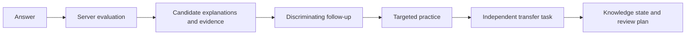

# VerbaTrail

**Turn mistakes into clues. Verify understanding in a new context.**

VerbaTrail is building an AI Agent-driven English learning and IELTS preparation platform, with **IELTS Overall Band 8.0** as a learning goal—not a score prediction or guarantee.

[简体中文](README.md) · [Latest application branch](https://github.com/KaoruMiyagawa/VerbaTrail/tree/feat/verbatrail-consolidation) · [Chinese README on that branch](https://github.com/KaoruMiyagawa/VerbaTrail/blob/feat/verbatrail-consolidation/README.md)

> **Main branch status:** `main` retains an earlier project baseline and does not yet contain the latest integrated IELTS Reading application or dual-theme UI. The screenshots and latest capability status below refer to the separate [`feat/verbatrail-consolidation`](https://github.com/KaoruMiyagawa/VerbaTrail/tree/feat/verbatrail-consolidation) branch. It has not been merged into `main` and is not a production release.

## Product direction

Typical practice tools stop after marking an answer right or wrong. VerbaTrail focuses on what an error may indicate, what evidence is still needed, and whether understanding transfers to a new question.

**Error DNA** is a planned product concept for organizing recurring, verifiable error signals. The latest development branch implements related foundations: competing hypotheses and evidence, state-driven follow-up, targeted practice, an independent transfer task, knowledge states and spaced-review scheduling. There is no calibrated Error DNA learner profile; long-term retention outcomes, real-model personalization quality and official IELTS scoring remain unvalidated.

This illustrates the product learning loop. Available steps depend on the code branch, server session state and assigned questions; it does not mean `main` contains the complete flow.

## Capability status

| Capability | Current `main` | Latest consolidated branch |
| --- | --- | --- |
| IELTS Reading | Does not contain the latest integrated Reading workspace | Academic and General Training Reading tasks and learning flow implemented; passed IELTS-1 stage acceptance |
| Diagnosis and practice | Retains earlier backend learning and diagnostic foundations | Competing hypotheses, evidence, follow-up, targeted practice and independent transfer; FakeModelProvider runs are simulations |
| Review and learning profile | Does not contain the latest integrated pages | Server-backed review tasks, history, knowledge states and related evidence are displayed |
| Premium / Noir themes | Does not include the dual-theme application UI | Premium Academic and Noir & Champagne are integrated into one React app |
| Listening, Writing, Speaking, Vocabulary, Grammar, Mock Tests | Planned | Planned; not delivered as complete features |
| UKVI, Life Skills | Planned | Planned; usable exam flows are not delivered |
| Real AI diagnosis, band prediction, official scoring | Unvalidated | Unvalidated; the project does not claim these capabilities passed quality evaluation |

### Real captures from the latest development branch

These are from an isolated Headless Chrome acceptance run. The Reading workflow used FakeModelProvider and does not demonstrate real-model performance. Narrow-screen captures are in the [acceptance evidence directory](https://github.com/KaoruMiyagawa/VerbaTrail/tree/feat/verbatrail-consolidation/docs/development/consolidation-browser-evidence).

<table>
  <tr>
    <td> Premium Academic · Home</td>
    <td> Noir &amp; Champagne · Home</td>
  </tr>
  <tr>
    <td colspan="2"> Academic Reading · passage and server-provided question</td>
  </tr>
</table>

## Technology and development links

The latest branch uses React, TypeScript, Vite, FastAPI, SQLAlchemy, SQLite and Alembic. The frontend renders server-provided tasks and states; the backend manages learning flows, persistence, diagnosis and review. The [architecture guide](https://github.com/KaoruMiyagawa/VerbaTrail/blob/feat/verbatrail-consolidation/docs/architecture/CURRENT_ARCHITECTURE.md) describes that development branch, not code already present on `main`.

- [Quick-start guide for the latest version](https://github.com/KaoruMiyagawa/VerbaTrail/blob/feat/verbatrail-consolidation/docs/development/QUICKSTART.md)
- [Implementation status and roadmap](https://github.com/KaoruMiyagawa/VerbaTrail/blob/feat/verbatrail-consolidation/docs/development/ROADMAP.md)
- [Browser acceptance report](https://github.com/KaoruMiyagawa/VerbaTrail/blob/feat/verbatrail-consolidation/docs/development/consolidation-browser-evidence/README.md)

The latest branch baseline has 80 backend and 40 frontend tests passing, with TypeScript typecheck and production build passing. Tests and browser acceptance use fixed fixtures and FakeModelProvider; real-model performance and production deployment still require separate validation.

## Roadmap

- Stabilize and review Academic / General Training Reading, Review, learning profile and dual-theme experience.
- Plan Listening, Writing, Speaking, Vocabulary, Grammar, Mock Tests, UKVI and Life Skills incrementally.
- Establish separate privacy, budget and quality gates for Error DNA, real models, score estimates and long-term learning outcomes.

Please open an issue to discuss improvements. No open-source license is currently declared; do not assume reuse or redistribution is permitted.