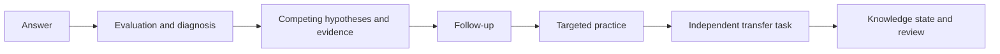
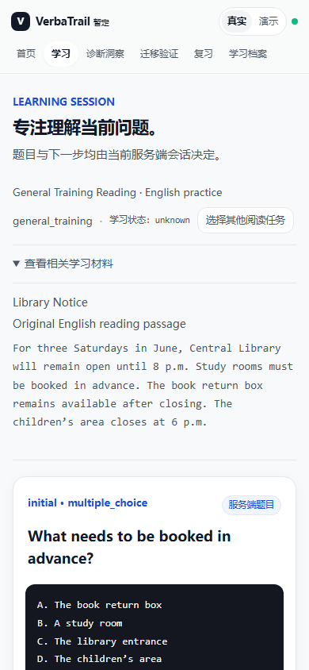

# UnlearnLoop

**Start with mistakes. Verify understanding in a new context.**

[中文](README.md) · [Quick start](docs/development/QUICKSTART.md) · [Architecture](docs/architecture/CURRENT_ARCHITECTURE.md) · [Acceptance report](docs/development/IELTS_1_FINAL_BROWSER_ACCEPTANCE.md) · [Contributing](CONTRIBUTING.md)

  

UnlearnLoop is a local MVP exploring evidence-driven learning. Rather than stop at right or wrong, it retains competing explanations, gathers evidence through follow-up questions and practice, and checks whether understanding transfers to a fresh task. Hypotheses and heuristic weights are provisional, not certain diagnoses.

> This README describes the **`feat/ielts-pivot` development branch**. IELTS-1 passed the specified isolated browser acceptance; it has not been merged into `main` and is not a production release. See the [default branch README](https://github.com/KaoruMiyagawa/UnlearnLoop/blob/main/README_EN.md) for its actual state.

## Learning loop



The server selects permissible transitions; not every answer follows every step. A passed transfer task does not prove long-term retention.

## What works on this branch

| Area | Status |
| --- | --- |
| IELTS Reading | Original English reading material, goal settings and separate Academic / General Training sessions. Other skills are planned. |
| Learning | Server-side attempts, diagnostic cases, hypotheses, evidence, follow-up, practice, independent transfer and session recovery. |
| Review and history | Scheduled reviews, history and knowledge states; the review displayed in browser acceptance was not yet due. |
| Interface | Real API and Demo modes; specified reading and answer screens were checked at 390px. |
| Models | `FakeModelProvider` simulates offline decisions. Remote provider adapters and gates exist; real-model quality, costs and reliability were not validated. |

The IELTS-1 acceptance covered the specified workflows in Headless Chrome. The recorded regression checks passed 80 backend tests, 40 frontend tests, typecheck and production build. See the [report](docs/development/IELTS_1_FINAL_BROWSER_ACCEPTANCE.md) for evidence and limits. This does **not** establish successful real AI personalization.

<p align="center"></p>
<p align="center"><sub>Actual browser capture from the isolated acceptance run</sub></p>

## Architecture and local setup

React, TypeScript and Vite render server-assigned tasks. FastAPI coordinates application services, domain rules, content evaluators and diagnostic decisions; SQLAlchemy, SQLite and Alembic persist state. A provider abstraction separates the offline fake from configurable model adapters. See [current architecture](docs/architecture/CURRENT_ARCHITECTURE.md).

Requirements: Python 3.11+, Node.js and npm. On Windows PowerShell:

```powershell
python -m venv .venv
.\.venv\Scripts\python -m pip install -r backend/requirements.txt
cd frontend
npm ci
cd ..
```

In one terminal:

```powershell
$env:DATABASE_URL = 'sqlite:///./unlearnloop-local-new.db'
$env:MODEL_PROVIDER = 'fake'
$env:ALLOW_REMOTE_MODEL_CALLS = 'false'
cd backend
..\.venv\Scripts\python -m uvicorn app.main:app --host 127.0.0.1 --port 18000
```

In another terminal run `cd frontend` and `npm run dev`, then open `http://127.0.0.1:15173`; API docs are at `http://127.0.0.1:18000/docs`. Development startup migrates the configured database and seeds content: choose a new path and back up existing data before using it. See the [quick start](docs/development/QUICKSTART.md). This is a trusted local, single-user MVP; `learner_id` is not authentication.

## Tests and layout

```powershell
cd backend
..\.venv\Scripts\python -m pytest
cd ../frontend
node --test tests/*.test.mjs
npm run typecheck
npm run build
```

`backend/` contains API, domain, persistence, content and tests; `frontend/` contains the interface and client; `docs/` holds plans, architecture, baseline archives and acceptance evidence.

## Roadmap and contribution

Before integration, review the branch and address or explicitly accept migration backup, data control, dependency and single-user security risks. Future work includes broader IELTS content and skills, accessibility, quality automation, and real-model evaluation with clear consent, budget and privacy boundaries. See the [implementation plan](docs/development/IELTS_IMPLEMENTATION_PLAN.md) and [MVP audit](docs/development/MVP_FINAL_AUDIT.md).

Issues and contributions are welcome; see [CONTRIBUTING.md](CONTRIBUTING.md). **No open-source license is currently declared.** Do not assume permission to reuse or redistribute; the maintainer must choose a license.
