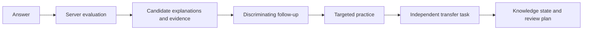
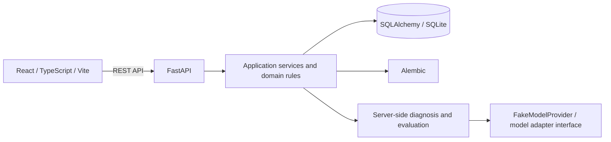

# VerbaTrail

**Turn mistakes into clues. Verify understanding in a new context.**

An AI Agent-driven English learning and IELTS preparation platform, with **IELTS Overall Band 8.0** as a learning goal—not a score prediction or guarantee.

[简体中文](README.md) · [Latest application branch](https://github.com/KaoruMiyagawa/VerbaTrail/tree/feat/verbatrail-consolidation) · [Quick start](docs/development/QUICKSTART.md) · [Architecture](docs/architecture/CURRENT_ARCHITECTURE.md) · [Roadmap](docs/development/ROADMAP.md)

> GitHub's default `main` branch does not yet contain the latest IELTS application. The latest consolidated work is on [`feat/verbatrail-consolidation`](https://github.com/KaoruMiyagawa/VerbaTrail/tree/feat/verbatrail-consolidation). It has not been merged into `main` and is not a production release.

## Product direction

VerbaTrail aims to help learners understand why an answer went wrong, instead of only counting attempts. **Error DNA** is our product direction for organizing recurring, verifiable error signals into learning hypotheses that can be tested with new questions.

The current implementation provides foundations for that direction: the backend records competing hypotheses and evidence, selects follow-up questions and targeted practice from session state, and checks transfer with an independent task. It also manages knowledge states and spaced-review schedules. **There is no calibrated Error DNA learner profile, official IELTS scoring, or validated real-model diagnosis quality.** Review scheduling exists; long-term retention outcomes have not been established through learning research.



The backend determines the actual path from session state and available tasks; not every answer triggers every step.

## Capability status

| Capability | Status |
| --- | --- |
| Reading | **Implemented:** IELTS Academic and General Training modes, original English materials, server-selected tasks and answer flow. |
| Diagnosis and practice | **Foundations implemented:** server-side Agent flow, competing hypotheses, evidence, follow-up, targeted practice and transfer checks. FakeModelProvider only simulates model responses. |
| Review and learning profile | **Implemented:** real ReviewItems, due information, history, knowledge states, transfer/delayed-review evidence and unknown states. |
| Dual-theme interface | **Implemented:** one React app with Premium Academic and Noir & Champagne; locally persisted preference and warm ivory reading surface. |
| Listening, Writing, Speaking | **Planned:** this is not yet a complete four-skill preparation product. |
| Vocabulary, Grammar, Mock Tests | **Planned:** complete learning flows are not available yet. |
| UKVI, Life Skills | **Planned:** usable exam flows have not been delivered. |
| Real-model diagnosis and band prediction | **Unvalidated:** no claim of real AI personalization quality, official scoring or band prediction. |

### Acceptance captures

These are captures from an isolated Headless Chrome acceptance run, not mockups. The reading workflow used FakeModelProvider and does not demonstrate real-model performance.

<table>
  <tr>
    <td><br><sub>Premium Academic · Home</sub></td>
    <td><br><sub>Noir &amp; Champagne · Home</sub></td>
  </tr>
  <tr>
    <td colspan="2"><br><sub>Academic Reading · passage and server-provided question</sub></td>
  </tr>
</table>

[Browser acceptance and mobile captures](docs/development/consolidation-browser-evidence/README.md) · [IELTS-1 dual-theme visual review](docs/development/theme-visual-acceptance/VISUAL_REVIEW.md)

## Architecture



The frontend renders server-provided tasks and states. The backend owns sessions, answers, idempotent recovery, diagnosis, transfer checks, knowledge states and review plans. SQLite is the local development default; Alembic history is retained in the repository. See the [current architecture](docs/architecture/CURRENT_ARCHITECTURE.md).

## Run locally

Requirements: Python 3.11+, Node.js, npm and Git. Run from the repository root:

```powershell
python -m venv .venv
.\.venv\Scripts\python -m pip install -r backend/requirements.txt
cd frontend
npm ci
cd ..
```

Start the backend in one terminal (`DATABASE_URL` is relative to `backend/`):

```powershell
$env:DATABASE_URL = 'sqlite:///./verbatrail-local.db'
$env:APP_NAME = 'VerbaTrail'
$env:MODEL_PROVIDER = 'fake'
$env:ALLOW_REMOTE_MODEL_CALLS = 'false'
cd backend
..\.venv\Scripts\python -m uvicorn app.main:app --host 127.0.0.1 --port 18000
```

Start the frontend in a second terminal:

```powershell
cd frontend
npm run dev
```

Open `http://127.0.0.1:15173`; API docs are at `http://127.0.0.1:18000/docs`. Development startup migrates the configured database; back up and verify any existing database first. See the [quick-start guide](docs/development/QUICKSTART.md) for ports and data notes.

## Tests

```powershell
cd backend
..\.venv\Scripts\python -m pytest
cd ../frontend
node --test tests/*.test.mjs
npm run typecheck
npm run build
```

The current baseline has 80 backend and 40 frontend tests passing. Tests use fixed fixtures and FakeModelProvider; they do not call paid models and do not validate real-model personalization.

## Repository layout

```text
backend/               FastAPI, application/domain services, content, Alembic and pytest
frontend/              React pages, theme tokens, API client and flow tests
docs/architecture/     Current system architecture
docs/design/           Dual-theme references, design system and archived concepts
docs/development/      Quick start, acceptance, browser evidence and roadmap
docs/archive/          Useful material superseded by current plans
```

## Roadmap

- **Current development:** stabilize and integrate IELTS Academic / General Training Reading, Review, learning profile and dual-theme experience.
- **Planned:** expand Listening, Writing, Speaking, Vocabulary, Grammar, Mock Tests, UKVI and Life Skills.
- **Separate quality gates:** real models, scoring and band estimates require independent privacy, budget, reliability and accuracy review.

See the [development roadmap](docs/development/ROADMAP.md). Contributions are welcome; please start with an issue and follow [CONTRIBUTING.md](CONTRIBUTING.md). No open-source license is currently declared, so do not assume redistribution rights.