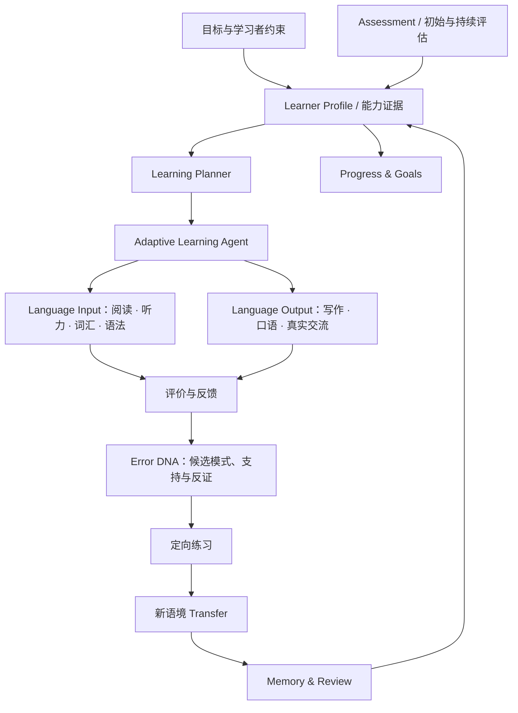

# VerbaTrail 目标架构

本文描述面向学习者中心语言学习系统的渐进式目标架构，不是当前功能清单。当前实现和质量边界见[CURRENT_ARCHITECTURE.md](CURRENT_ARCHITECTURE.md)；产品能力及优先级见[产品方向](../product/IELTS_PRODUCT_DIRECTION.md)和[路线图](../development/ROADMAP.md)。

## 架构原则

1. **先模块化单体，后按实际需要拆分。** 当前 React + FastAPI + SQLAlchemy 架构足以演进，不因愿景提前引入微服务。
2. **学习者模型与活动内容分离。** 学习者的目标、能力证据、偏好和约束不绑定于 IELTS 某一种题型。
3. **所有判断有来源。** 任务、作答、规则/模型/人工评价、诊断、迁移和复习都应带来源及版本。
4. **未知是合法状态。** 不把缺失数据、规则启发式或单次正确答案换算成确定能力或统计置信度。
5. **Agent 在策略和工具边界内运行。** Agent 可选择已允许的下一步学习活动，但不能越过内容、状态、身份和隐私规则。
6. **语言扩展采用分层设计。** 通用学习与证据概念可复用；文字、语音、内容、课程和评价仍按语言及场景适配。当前未实现多语言教学。

## 目标产品能力层

此图是目标能力关系。当前仅有部分 IELTS Reading 与受约束诊断/迁移/复习路径，尚无完整 Learner Profile、Assessment、Planner 或跨技能 Adaptive Agent。

## 领域边界

### Learner Profile 与能力证据（规划）

保存学习目标、考试或语言场景、偏好、时间约束和不同能力维度的证据摘要。每条证据需记录来源 Attempt/活动、内容与评价版本、时间、状态及不确定性。派生能力结论应可重算；错误或失效证据应能撤销其派生影响而保留原始记录。

### Assessment（规划）

管理初始及持续评估蓝图、任务选择、评价来源和覆盖范围。考试目标如 IELTS Band 与基础语言能力模型分开；未经校准的测试结果不能作为官方分数或 Band 预测。

### Learning Planner 与 Adaptive Agent（规划，部分策略基础已存在）

Planner 将目标、能力证据、可用时间和可用内容转成可解释的学习路线。Agent 在服务端状态机内选择下一项合法行动，并提供目标能力、选择依据、待收集证据及降级原因。Agent 工具只能访问授权范围内的学习数据和已发布内容。

### Language Input / Output（部分实现）

阅读、听力、词汇、语法构成理解输入；写作、口语和交流构成表达输出。每类活动定义自己的内容、答案结构、评价器和证据语义。当前 Reading 有版本化题组基础；其他模块需独立设计，不能假定任意文本题共用相同评分。

### Feedback 与 Error DNA（部分实现）

保存客观观察与候选原因的区别，支持多种竞争假设及其支持、削弱、中性或不足证据。证据至少关联任务、Attempt、题项、版本和评价来源。只有达到明确证据门槛后才能改变工作状态；启发式权重不得作为真实统计概率展示。Error DNA 服务于整个学习循环，但不是唯一用户价值。

### Transfer、Memory & Review（部分实现）

Transfer 必须使用新材料和新语境，记录独立作答与评价。Review 按服务端排程派发独立任务，记录到期、结果和保持证据。一次迁移和一次复习不是永久掌握证明；题库耗尽或历史证据失效必须有显式状态与恢复流程。

### Progress & Goals（部分实现）

展示用户设定目标与当前可验证证据的差距，并区分已测、未测、过期和待复核状态。不得仅根据题量、模型输出或练习正确率生成整体能力结论。

## 技术分层目标

保持当前前后端分离模块化单体，逐步明确以下边界：

- **Presentation：** React 工作区、可访问交互、主题令牌、API Client 和可恢复草稿。
- **API：** FastAPI schema、认证与授权（当前未实现生产级身份体系）、版本化资源及错误语义。
- **Application：** 会话、评估、计划、Agent 行动、迁移与复习用例编排。
- **Domain：** 学习目标、能力证据、错误假设、内容约束和状态转换规则。
- **Content / Evaluation：** 语言/技能内容包、题型 schema、私有答案键、评价规则版本与审校来源。
- **Agent / Model Adapter：** 策略选择、受限工具、模型提供方适配、超时/拒答/schema 校验及来源记录。规则与模型决策必须可区分。
- **Persistence：** SQLAlchemy 仓储及 Alembic 增量迁移；测试隔离数据库；历史证据不可静默覆盖。
- **Observability / Governance：** 脱敏事件、可重放决策、数据保留与删除、成本和质量监控（需在产品化阶段建设）。

## 安全、隐私与可靠性

- 身份验证和每个对象上的授权检查应先于多用户或云部署；当前 `learner_id` 不是认证凭证。
- API 只返回学生必要字段；答案键、内部规则和提示不可泄露。
- 写操作采用可重复验证的幂等键及服务端事务；并发派题/提交不能重复改变学习状态。
- 会话与 Attempt 固定内容及规则版本；内容升级不改变既有作答含义。
- 数据库迁移须向后兼容并在隔离 SQLite 验证；操作真实数据前先验证备份恢复。
- 真实模型调用应显式配置、获得适当同意并受隐私、成本、时延、质量和内容安全约束。FakeModelProvider 只用于开发流程，不是模型质量验证。

## 递进实施

按[路线图](../development/ROADMAP.md)推进：先修复 Matching Headings Phase 6 历史证据有效性与状态重算；再建立共用能力模型和初始评估；然后规划个性化路线与 Agent 策略；之后逐步扩展听说读写、词汇语法、长期记忆和跨技能迁移；最后评估其他语言与更完整的智能教学能力。每一步都要先定义内容质量、证据语义、隐私与验收标准。
