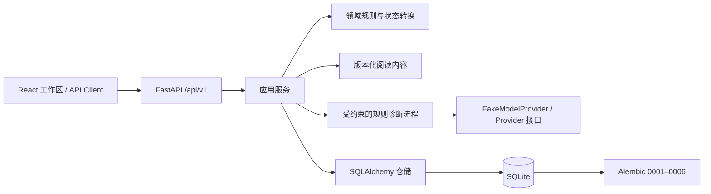

# VerbaTrail 当前架构与能力边界

更新日期：2026-11-12。本文描述当前 VerbaTrail 的代码结构及已知边界；目标产品关系见[产品方向](../product/IELTS_PRODUCT_DIRECTION.md)，长期技术目标见[目标架构](ARCHITECTURE.md)。

## 当前运行架构

- **前端：** React、TypeScript、Vite 和单一 API Client。学习、诊断、迁移与复习工作区共享组件及业务流程；Premium Academic / Noir & Champagne 由 ThemeProvider、`data-theme` 和 CSS Variables 驱动。
- **HTTP/API：** FastAPI 提供版本化 `/api/v1` 接口。API schemas 对学生可见数据建模，题组展示内容与私有答案键/评分规则分离。
- **应用服务：** 应用层编排考试配置、内容/题目选择、学习会话、提交、诊断、专项训练、Matching Headings 迁移与复习。
- **领域与评价：** 领域规则验证学习状态转换、Matching Headings 题组及逐项评价。规则协议和 FakeModelProvider 支持流程执行与测试，不构成真实模型个性化质量证据。
- **持久化：** SQLAlchemy 仓储保存内容版本、Question、LearningSession、Attempt、诊断假设/证据、KnowledgeState 和 ReviewItem；Alembic 当前单一 head 为 `0006_matching_headings_review_provenance`。测试和浏览器流程使用隔离 SQLite。

## 当前 IELTS 实现范围

Academic 与 General Training 有有限的 Reading 流程，包括 TFNG 及 Matching Headings 结构化题组；Matching Headings 已接入固定内容版本、逐项评分、错误假设、追问、针对性训练、独立迁移和首轮延迟复习。历史、Review 和 Profile 消费服务端记录。

**IELTS-2B.1 Phase 6 综合验收为 FAIL。** Phase 4 早期部分 Matching Headings 迁移/复习答案依据有误。新的内容版本已更正，受影响的旧版本不能继续产生新的迁移/保持验证；但历史 Attempt 与派生 KnowledgeState / ReviewItem 尚没有可信度标签、重算流程及用户恢复路径。因此不能认为所有旧学习状态准确。详情见[最终验收报告](../development/IELTS_2B1_FINAL_ACCEPTANCE.md)。

完整 IELTS Reading 题型覆盖、Listening、Writing、Speaking、完整词汇/语法课程、模考、统一能力评估、个性化学习计划、多语言教学均未实现。目标架构中的 Learner Model 和跨技能 Adaptive Agent 也还未完整落地。

## 证据与数据流

Matching Headings 当前典型流程：

`版本化题组 → 服务端派发并固定版本 → 结构化 Attempt 与逐项评分快照 → 候选诊断假设及证据 → 合法追问/专项训练 → 独立迁移 → ReviewItem / 延迟作答`

前端显示服务端返回的题型、评分及下一步状态，不应据本地分数推断掌握状态。规则诊断的来源应明确，候选假设不等于确认原因。训练、迁移和延迟保持是不同证据层级。当前流程主要覆盖首轮迁移/复习；旧版证据有效性仍待修复，更多独立复习周期也未完成。

## 安全与信任边界

- 当前应用适合可信的本地单用户开发，不是生产级多用户服务。
- `learner_id` 是调用方可提供的筛选字段，不是认证或授权。按对象 ID 读取的部分接口未绑定经验证的用户身份；不能宣称已有租户隔离。
- 本地 FakeModelProvider 和规则执行不代表实时 LLM 成功，也不保证语义诊断正确。真实远程模型能力与质量尚未通过验证。
- 答案键及内部评分规则不得由学生题目/历史 DTO 返回；作答快照、题目版本和评分规则版本应保持可追溯。
- 开发和浏览器验证使用隔离 SQLite。服务启动会迁移配置的数据库；使用既有数据前应先做可恢复备份。
- 不应提交 `.env`、API 密钥、SQLite 学习数据、日志或本地缓存。

## 与目标架构的差距

当前系统是模块化单体：React + FastAPI + SQLAlchemy/SQLite。后续可在不提前拆微服务的前提下，逐步引入统一 Learner Profile/能力证据、Assessment、Learning Planner 和跨技能 Agent 策略。Listening、Writing、Speaking 需各自建立内容模型、证据与评价协议；其他语言扩展应将通用学习模型与语言特定内容/评价规则分层。上述均为规划，不代表现有可用功能。
