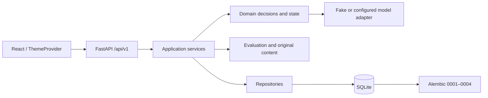

# VerbaTrail 当前架构与能力边界

本说明描述 `feat/verbatrail-consolidation` 所基于的 IELTS-1 实现状态。`ARCHITECTURE.md` 与规划档案保留目标设计，不代表每项目标均已实现。

## 当前架构

- **React / TypeScript / Vite**：单一应用和 API Client。Premium Academic / Noir & Champagne 通过一份 ThemeProvider、`data-theme` 和 CSS variables 切换；不复制业务流程。
- **FastAPI**：版本化 `/api/v1` 端点提供考试设置、题目、会话、作答、诊断、迁移、复习与档案读取。
- **应用与领域服务**：服务端决定可用动作，保存 attempt/diagnostic/evidence、幂等意图、knowledge state 与 ReviewItem。前端不自行推定掌握。
- **评价与 Agent**：原创阅读内容、规则评价和 schema 校验的诊断决策。FakeModelProvider 可驱动模拟决策；真实模型适配可配置，但未通过个性化质量/生产验证。
- **持久层**：SQLAlchemy + SQLite，Alembic `0001`–`0004`。`unlearnloop.db` 为保留的历史数据库文件名；默认示例使用新的 VerbaTrail 数据库。

## IELTS-1 已验收范围

Academic 与 General Training 阅读任务、设置、独立会话、服务端作答和评价、Agent 诊断追问、定向练习、迁移验证、学习历史、复习与 profile 在指定隔离环境中通过阶段浏览器验收。真实模型、生产环境、多用户认证、Writing/Listening/Speaking、UKVI 和 Life Skills 不在已验收范围。

## 数据与安全边界

服务启动可升级配置的数据库并导入内容。迁移前必须备份并验证恢复。当前应用是本地单用户工程，`learner_id` 不是认证凭证。默认配置关闭远程模型调用；测试和本地示例使用 FakeModelProvider。真实模型调用需单独明确配置并评估隐私、预算和质量。

浏览器、API 自动化测试须使用隔离数据库。不要把 `.env`、密钥、日志、真实用户数据库或依赖缓存加入 Git。
