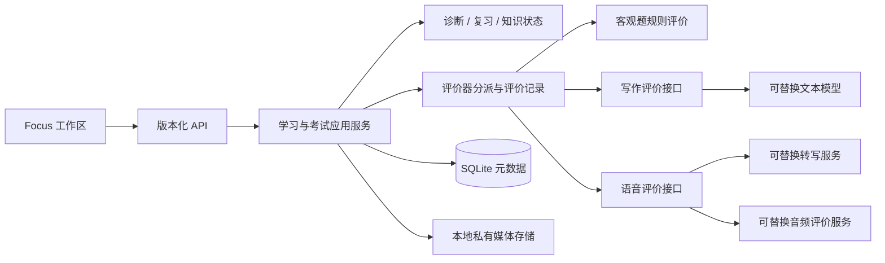

# IELTS 架构审查与迁移计划

状态：设计提案，未经实现；基线 `03ed2270005956d3bce5f713c4ca03bd0f119590`。此文档中的表、字段、端点和协议是计划，不代表当前 API 已支持。

## 1. 现状：可复用与耦合

| 现有位置 | 已有能力 | IELTS 的处理 |
| --- | --- | --- |
| `domain/enums.py`、`domain/rules.py` | 会话/诊断状态、证据关系、迁移前置条件 | 复用状态含义和约束，先增加类型/评分状态的适配；`stable` 仍只是当前独立验证通过，不映射 IELTS band |
| `application/learning_service.py`、`api/v1/sessions.py` | 会话、当前题、提交幂等、追问/练习/迁移编排 | 保留 v1 和历史行为；将领域专属评价从服务中抽出，经显式协议分派；单题会话要扩展题组和整卷，不能只替换内容包 |
| `decision/agent_engine.py`、`tools.py`、`heuristics.py` | 假设、正反证据、预算、白名单动作和决策事件 | 复用受控编排；先移除/隔离 `RuleEvaluationResult` 中输出值及 trace 假设，传入领域无关的证据；阅读/听力/写说使用经审校的错误标签 |
| `evaluation/rule_evaluator.py` | `expected_output`、文本前缀、`has_reasoning_or_trace`、错误映射；服务层直接实例化它 | 保留作 Python 评价器；这些启发式不能判定英语选择、填空、作文或语音。提供按题型和规则版本选择的评价器注册表，未知类型拒绝评价 |
| `persistence/models.py` | Topic/Material/Question/Attempt、证据、状态、复习和不可变历史 | 基础实体可渐进扩展。Question 目前要求字符串 `standard_answer`、单个 `context_snippet`；Attempt 为单个 `submitted_answer` 文本，不能表示音频、多空和多维评价 |
| `persistence/seed.py`、`content/python_basics_pack.json` | 按内容包导入、Python snippet 用 `ast` 校验 | 保留 Python 包和已有 ID；新内容包按 domain + schema version 使用专属验证，严禁把图文或音频送到 Python 语法检查 |
| `application/learning_service.py`、`repositories.py` | `ReviewItem`、到期校验、幂等调度、真实作答、保持证据 | 复用为技能/题目的复习调度基础；多题组和主观评分完成后才产生复习证据，题库独立性规则需按材料/题组版本加强 |
| `model_provider/` | OpenAI-compatible 文本结构化协议、FakeModelProvider、关闭远程调用选项 | 可复用文本模型调用边界、日志和测试注入；现有接口不是音频转写/音频评价协议，Fake 默认诊断含 Python 中间计算文案，须使用英语专用可辨识 fixture |
| `frontend/src/learning-workspace/RealLearningWorkspace.tsx`、`review-workspace/` | 真实会话、草稿、幂等恢复和 Focus 展示 | 保留交互基础；当前 textarea、`QuestionType`、`default_learner` 和单题流程不足以支持题组、录音与整卷。Demo fixture 含 Python 文案 |
| `api/v1/schemas.py` | 去除标准答案的题目响应，提交文本最大 2000 字符 | v1 继续兼容；不可用它截断作文或把多空/录音编码为假文本。公开题面和私有答案需继续分离 |

现有 Python 能力已有自动化覆盖，详见 [MVP 审查](../development/MVP_FINAL_AUDIT.md)；这不等于 IELTS 功能已完成，也不证明真实模型评分可用。

## 2. 目标分层与责任

先采用单体 FastAPI + SQLite 和文件存储。评价可在请求外执行，但不预先引入分布式框架：先用持久化任务表及单进程执行器；用户体验或可靠性要求证明需要时再独立 worker。Job 生命周期只是执行状态，不替代已有领域会话、诊断和掌握状态。

## 3. 内容、作答和评价模型

下列字段为提案中的最小集合；具体列名及约束在对应阶段的实现设计中确定。

| 实体 | 关键字段和关系 | 职责与约束 |
| --- | --- | --- |
| `ContentPack` | `id, domain=ielts, edition, schema_version, license_id, version` | 原创/许可、可撤回及幂等导入；保留 `python_basics_v1` |
| `Skill` / 现有 Topic | `id, domain, skill, subskill, topic_id?` | 四科与词汇/语法/发音多对多关联；一题可覆盖多个子技能，避免把某题等同于完整能力 |
| `TaskGroup` | `id, version, module=academic/general/shared, skill, part, instructions, time_policy_id, ordered_question_versions` | 一篇文章/一段录音/一组相关题；顺序、素材与公共说明可稳定回放 |
| `ContentAsset` | `id, version, kind, mime, size, sha256, license_id, locale, duration_ms?, alt_text?, storage_key` | 阅读文本、图表、图示、音频；可有授权的时间片段/文本锚点；私有文件不使用静态公开目录 |
| `Question` / `QuestionVersion` | `id, version, group_id, role, interaction_kind, prompt, options, constraints, skill_ids, private_rubric_ref` | `role` 是初始/追问/练习/迁移/复习；`interaction_kind` 是选择、填空、长文、录音等，二者正交。发布后版本不可原地覆盖 |
| `QuestionKeyVersion` | `question_version_id, allowed_answers, normalization_policy, word_number_limit, scoring_rule_version` | 只供服务端客观题评价；一个题目可多空、多个经审校答案，不默认模糊匹配 |
| `Attempt` + `AttemptResponse` | 现有 attempt ID 与新 `response_version, kind, payload_json or recording_asset_id, created_at` | 一次意图可包括多个子题答案或一段录音。保留原始内容，规范化只供评价；作答不得包含标准答案 |
| `Evaluation` / `DimensionEvidence` | `attempt_id, evaluator_id/version, rubric_version, status, result, dimension, evidence_ref, uncertainty, provider metadata` | 客观评价保存逐空正确性；主观评价保存每维观察、原文范围/音频时间戳、弃评和版本。增加新评价记录，不覆盖原始作答/旧结果 |
| `DiagnosticCase` / `EvidenceLink` / `DecisionEvent` | 继续关联 attempt 与来源；扩展到 `evaluation_id, question_version_id, evidence_ref` | 支持竞争假设、支持/反对/中性、理由及来源；不复制另一套学习状态机 |
| `ReviewItem` | 继续关联 learner/topic/attempt，并可引用 skill 和独立题组版本 | 到期、计划、评价及新计划由服务端决定。答题未评价、材料不可用、题库耗尽时保持未确认/待办 |
| `StudyPlan` / `PlanItem` | 目标日期、周时间、目标/当前证据、推荐原因、到期及完成记录 | 从可审计规则生成；计划可以调整；自报成绩与系统证据分源 |
| `ExamBlueprint` / `ExamRun` / `ExamSection` | 考试种类、版本、题组顺序、时限、已耗时、状态、开始/提交时间、规则版本 | 独立区分练习/模拟；考试流程可包含多个会话/题组，但学习证据仍使用统一 Attempt/评价/事件 |

**示例 Response 的类型联合**：`choice {option_ids}`、`matching {item_id: option_id}`、`blanks {blank_id: text}`、`short_text {text}`、`essay {text}`、`speech {recording_asset_id, duration_ms}`。服务端定义每类型大小上限和规范化规则；不把文字转写替换原始音频，也不把文件路径当公共 ID。

内容包的 `domain_code`、`module`、`skill`、`role`、`interaction_kind` 和 `rubric_version` 是不同维度。每个题组保存原创或授权素材版本与来源；同一素材的改写不自动成为独立迁移证据，首版依人工审核的 `independence_group_id` 过滤，语义独立性仍有不确定性。

## 4. 评价协议与 API 草案

业务层调用 `Evaluator.evaluate(attempt_ref, question_version_ref, rubric_version, context) -> EvaluationResult`。结果包含 `status = pending | complete | insufficient_evidence | failed`、`objective_items?`、`dimensions?`、`evidence[]`、`uncertainty`、`evaluator/provider/version`、`created_at`。`failed` 不等于答错；仅确认完成的有效评价可以触发复习/状态迁移。对写作/口语不将评价强制塞入 `is_correct: bool`。

### 写作评价（提案）

`WritingEvaluator` 接收题目版本、题面/许可图示语义、原始文本、task 与 rubric 版本。响应每维为 `{criterion, status, observations[], evidence: [{start, end, quote_ref}], suggestion, estimated_band_range?}`；偏移以约定的 Unicode 标量索引计算并验边界，保留原文版本。Task 1 采用 Task Achievement，Task 2 采用 Task Response，另含 Coherence and Cohesion、Lexical Resource、Grammatical Range and Accuracy。图表事实缺少可读数据时标记不足；语法反馈与事实判断分开。只有通过独立校准并获得产品批准后才能返回非官方分数区间；否则返回定性反馈。

### 口语评价（提案）

`Transcriber.transcribe(audio_ref, language, consent_id)` 输出带 provider/model/version 的文本、分段时间和不确定性；允许用户更正转写，原始版本保留关联。`SpeakingEvaluator.evaluate(audio_ref?, transcript_ref?, task_ref)` 输出 Fluency and Coherence、Lexical Resource、Grammatical Range and Accuracy、Pronunciation 四维及音频时间段。**没有音频能力时 pronunciation 为 `insufficient_evidence`；不能由文本转写伪造发音评价**。录音噪声、设备、口音及转写差错可能影响反馈，展示适用范围与纠错入口。

### 未来 HTTP 接口（非现有契约）

| 方法与路径草案 | 输入 / 输出及约束 |
| --- | --- |
| `GET /api/v2/task-groups/{id}` | 返回授权可见题组版本、公开素材引用及排序；排除私有答案/隐藏转写 |
| `POST /api/v2/sessions/{id}/responses` | `question_version_id`、类型化 `response`、`idempotency_key`；返回 attempt ID 和 `evaluation_status` |
| `GET /api/v2/attempts/{id}/evaluation` | 返回客观逐项或主观多维结果、证据引用、来源及不确定性；未完成返回 pending |
| `POST /api/v2/recordings` / `GET /api/v2/recordings/{id}` | 授权上传/读取个人录音，限制大小、MIME、时长、来源并核验；本地优先。返回不暴露文件路径的 ID |
| `POST /api/v2/attempts/{id}/transcriptions` | 明确转写 provider 与同意记录；返回任务 ID，失败可恢复；禁止隐式远程传输 |
| `POST /api/v2/exam-runs` / `GET .../{id}` / `POST .../{id}/submit` | 固定 blueprint 和版本，服务端记录计时与提交；禁止自称官方监考 |
| `GET /api/v2/profile/evidence`、`POST /api/v2/data-export`、`DELETE /api/v2/data` | 先完成本机权限、确认和删除策略；异步导出/删除的进度与可验证结果可查询 |

新写接口的幂等意图绑定 `learner/session/question_version/mode/response` 及录音内容哈希；相同键同内容重放相同结果，不同内容返回冲突。提交后先持久化 attempt 和任务，再调用可失败的外部 provider；重启/超时后先读取权威状态，不自动重放可能产生费用的未知结果。任务完成写入评价、证据及状态更新应在事务内有唯一约束；异步媒体文件与数据库不能跨资源原子提交，须有上传状态、校验、孤儿清理和失败补偿。

## 5. 音频端到端

1. **听力播放**：浏览器请求经权限检查的音频资产；服务端返回允许的版本与 MIME。练习可重听/跳转并保留授权限制；模考以服务端记录开始、播放次数和失效/恢复策略。浏览器不提供防录屏或严格防重听保证。
2. **录音**：用户明确授权麦克风；浏览器协商支持的格式，显示录音、停止、时长与试听。上传前限制时长/大小、计算校验和；断网时保留可重试草稿并告知设备本地存储限制。
3. **存储**：默认本地私有目录，数据库保存不透明引用、哈希、属主、格式、长度及状态；不把私人音频放在 Vite 静态目录或 Git。上线前决定加密、容量、恶意文件防护、保留期和备份策略。
4. **转写**：仅在用户授权的处理范围内调用离线或远程 provider。失败保留录音和状态，可显式重试；模型输出与用户纠正分别版本化。
5. **反馈**：评价器引用音频和/或转写版本。证据支持四维中的哪些维度就输出哪些；低质量、不可访问、超预算或无音频评价能力时弃评并告知原因。
6. **删除/导出**：设计贯穿录音、转写、评价引用、缓存及备份；参考不可变审计记录采用经审查的最小化/匿名化策略，不把业务不可变约束当作永远无法删除个人数据的理由。

## 6. 数据库增量演进与回退

**迁移从现有 Alembic `0003_evidence_based_reviews` 之后开始；本次不生成迁移或修改数据库。**

1. 在迁移开发前为 SQLite 使用在线备份 API 生成独立副本，校验完整性、hash 和可恢复性；开发启动当前会自动升级，必须先补齐可靠备份/失败提示，避免首次启动静默改写唯一数据副本。磁盘不足、备份失败或文件被占用时阻止迁移并给出处理方式。
2. 新增可空关联、题组/题目版本、私有答案和媒体元数据等增量表；任何对 SQLite 表的 batch 重建先在旧库副本验证外键、索引、约束和事务行为。旧 Python 的 Question、Attempt、Review、DecisionEvent/Evidence、知识状态和 ID 原样保留。
3. 回填旧题的版本引用时，以旧题当前版本及历史 `question_snapshot_json` 为来源；对缺少历史字段的记录标 `legacy_unknown`，不以当前题面伪造历史。记录每次回填数、校验和、失败行；可重入且不能重复插入。
4. 引入类型化 response 前，设计 SQLite batch 修改使 `standard_answer`、`submitted_answer` 对 v2 主观题可为空；对旧版 Python 以服务/数据库条件约束保持原有非空语义。新题用真实 `QuestionKeyVersion` 或主观 rubric，绝不以空字符串冒充正确答案。迁移期间不破坏 v1 API、现存幂等键和复习约束。
5. v1 路由继续处理 legacy 文本题；v2 通过题目版本与交互类型分派，未知题型、错误 schema 或 v1 访问不兼容题型返回清晰错误。新评价器的开关默认关闭，先用隔离数据库和 Fake provider 验证。
6. 发布采用扩展→双读/对照→逐步启用→验证→可选收缩。回退应用时保留新旧字段，不强制 downgrade 抹除 IELTS 数据；从经过校验的迁移前备份恢复属于有数据丢失窗口的操作，须明确提示并由用户决定。任何新写入之后的回滚需要另行导出/合并方案。
7. 验收在临时库覆盖空库 0001→head、含 Python sessions/attempts/evidence/reviews 的 0003→新版本、反复启动/导入、外键检查、同键重试、异常中断、备份恢复以及旧 API 回归。迁移前后对比记录数、主外键、答案快照、题目版本和状态；不把旧 Python 数据转换成 IELTS 证据。

## 7. 安全与运维边界

- 当前是 loopback 单用户，无认证；不能把用户提供的 `learner_id` 当授权主体。多用户/云部署前新增身份、授权、资源归属、CSRF/CORS 等边界并测试。
- 远程文本、ASR 与音频模型分别设置开关、提供商、数据处理同意和预算；默认关闭。失败/预算耗尽返回明确状态，不用 Fake 结果冒充真实模型。
- 最小化发送内容、限制日志；密钥只存环境/安全凭据，严禁放入素材、Git、错误响应或完整模型日志。对上传媒体限额并做格式/内容核验。
- 人类审校、真实模型质量、音频保留和估分校准需要独立验收。离线 fixture 只证明接口和错误处理，不证明分数可靠。
