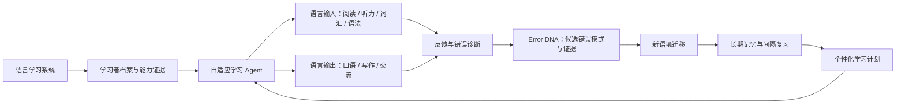

# VerbaTrail 产品方向

更新日期：2026-11-13。文件名沿用早期 IELTS 项目。本文件描述 VerbaTrail 的整体产品方向。

## 愿景与首个目标场景

VerbaTrail 是以学习者为中心、由自适应学习 Agent 驱动的语言学习系统。通过学习者当前能力证据、个性化练习、持续反馈和复习，帮助学习者逐渐建立理解、表达和真实使用语言的能力。

首个明确目标场景是 **IELTS Overall Band 8.0**。这是学习者可设定的备考目标，不代表当前水平，不是分数预测，也不是成绩保证。长期愿景超越考试题目：帮助学习者真正掌握一门语言。

Learn 提供四项技能入口。当前可练习的范围包括部分 IELTS Reading 工作流及配套的诊断、训练、迁移和首轮复习，以及一套有限原创 IELTS 风格 Listening 练习（合成音频、5 道选择题、规则评分、解释和时间锚点）。这不是完整 IELTS 听力考试，不提供官方 Band 分数，也不形成长期能力、迁移或保持结论。统一语言能力评估、跨技能个性化计划和真实模型教学质量仍待建设或验证。

## 产品关系

- **Learn（学习）** 提供 Listening（听力）、Speaking（口语）、Reading（阅读）、Writing（写作）四个一级板块。Reading 接入现有练习，Listening 和 Writing 各支持一套原创练习，Speaking 保留规划详情页。
- **Discover（发现）** 将为学习活动提供有明确来源和许可的外部资源，当前为规划中。
- **Adapt（自适应）** 将利用学习者目标、能力证据和学习历史做个性化规划与决策，当前为规划中。

词汇、语法、Error DNA、迁移、复习、学习历史与能力评估是跨技能共享能力。学习者目标、能力证据与学习历史由共享服务管理。

图示是目标产品关系，不是现有完整架构。**Error DNA 是反馈能力的一部分**：记录可观察错误、维护竞争性候选原因，并以追问、练习及新情境任务收集证据。它不等于完整学习者模型，也不应凭一次错误确认稳定弱点。

## 目标能力模块

| 模块 | 产品职责 | 当前状态 |
| --- | --- | --- |
| Learner Profile | 目标、背景、偏好、当前能力证据、未知项和学习约束 | 现有档案及知识状态 API 提供基础记录；未形成完整、校准的语言能力模型 |
| Assessment | 初始水平评估及持续能力评估 | 当前水平仍可为待评估；完整基线评估未实现 |
| Learning Planner | 把目标、能力证据和可用时间组织成可解释的学习路线 | 未实现统一个性化计划 |
| Language Input | 阅读、听力、词汇、语法与理解 | 部分 IELTS Reading 已实现；有限原创 Listening 练习已实现；完整听力、词汇和语法体系未实现 |
| Language Output | 写作、口语和真实交流表达 | Writing 支持一套原创 Task 2 题目，可保存草稿、提交、修订和比较。自动反馈限于可观察的文本指标。口语与交流练习仍为规划。 |
| Adaptive Agent | 基于状态与证据选择下一项合适活动，并能解释依据和不确定性 | 已有受约束的后端诊断/派题流程；未有经过验证的跨技能自适应教学 Agent |
| Error DNA | 整理错误观察、候选原因、支持/反证与后续验证 | 已在部分 TFNG 与 Matching Headings 流程中实现；质量边界见 Phase 6 验收 |
| Memory & Review | 复习排程、到期任务、延迟证据与长期记忆追踪 | ReviewItem 与首轮延迟复习路径已有实现，历史证据有效性协调已在隔离库复验，多轮保持待验证 |
| Transfer | 在新材料、新语境中检查能力能否迁移 | 部分 Reading 路径已有独立迁移；不等于稳定掌握 |
| Progress & Goals | 显示目标、真实进展、证据来源和未知能力 | 已有考试目标与档案基础；没有校准 Band 估分或完整四科能力追踪 |

## 学习原则

1. 先区分目标与当前能力；没有评估证据时明确标记未知。
2. 学习活动应能追溯到服务端题目版本、作答和评价来源。
3. 初始错误只形成候选解释；证据不足时保留不确定状态。
4. Agent 选择追问、训练或复习时，应检查合法内容与当前会话状态。
5. 训练正确、独立迁移通过、延迟保持验证是不同证据，不相互替代。
6. 人工、规则、FakeModelProvider 与真实模型输出必须分开标记；不把规则执行描述为经验证的 AI 语义理解。
7. 学习计划应解释选择依据、可选行动和未知项，避免把 IELTS 目标分数伪装成当前能力。

## 当前 IELTS 产品状态

- Academic 与 General Training 是当前可用考试模式，但阅读内容规模有限。
- TFNG 与 Matching Headings 有部分服务端流程；Matching Headings 有原创题组、结构化作答、逐项评价、诊断、训练、独立迁移和首轮延迟复习实现。
- **IELTS-2B.1 Phase 6.2 最终工程验收为 PASS WITH LIMITATIONS。** 证据有效性登记、状态协调及重新验证已通过隔离复验，正式库尚未执行协调，独立内容审校和生产发布评估仍待完成。原 Phase 6 FAIL 记录继续保留。[Phase 6.2 复验](../development/IELTS_2B1_PHASE6_2_ACCEPTANCE.md) · [原 Phase 6 报告](../development/IELTS_2B1_FINAL_ACCEPTANCE.md)
- Listening 有一套有限原创合成音频练习。Writing 有一套原创 Task 2 练习，作文的论证、语言质量与 Band 尚未评估。Speaking 仍为规划页。完整 IELTS 考试、完整 Reading 题型、词汇语法课程、模考、UKVI、Life Skills 和多语言教学尚未实现。
- FakeModelProvider 与规则诊断只支持隔离开发和流程验证，不能证明真实模型或产品级个性化有效。

## 规划原则

- 扩展学习能力时继续沿用可追溯的证据有效性处理和状态重算机制。
- 内容包有独立 ID、版本、来源/授权和答案依据；新内容需单独审校。
- 扩展其他语言时，将通用学习模型与 IELTS 考试规范分层；当前不宣称已支持其他语言。
- UKVI 与 Life Skills 必须采用适合各自考试目标的独立目录与流程，不把 Life Skills Band 化，也不虚构与基础 IELTS 不同的题型。
- 真实模型接入须经过隐私、成本、质量、拒答与人工对照评估；未完成前不作为产品能力承诺。

## 非目标与安全边界

- 不承诺用户取得 IELTS 8.0，也不输出官方 IELTS 成绩。
- 不根据单次答题或规则启发式生成统计概率、稳定标签或完整能力画像。
- 当前 `learner_id` 是本地查询筛选字段，不是登录凭证；系统不是生产级多用户服务。
- 本地默认 Fake provider、远程模型调用关闭。真实音频、作文和学习记录的远程处理在明确用途、供应商、地区、保留期和同意流程之前不应开放。
- 当前原创 Reading 内容仍需独立编辑及 IELTS 专家审校；内部检查不等于外部认证。

## 版本与官方规则

题目内容、展示 schema、答案规则、考试目录和评价器分别追踪版本。更新规则时保留历史题目与 Attempt，不回写既有证据。IELTS 官方格式或适用要求需在发布相应产品版本前重新核查权威来源；仓库版本号不代表官方版本。

参考资料：

- [IELTS test types](https://ielts.org/take-a-test/test-types)
- [IELTS Academic](https://ielts.org/take-a-test/test-types/ielts-academic-test)
- [IELTS General Training](https://ielts.org/take-a-test/test-types/ielts-general-training-test)
- [IELTS scoring](https://ielts.org/take-a-test/your-results/ielts-scoring-in-detail)
- [IELTS Life Skills](https://ielts.org/take-a-test/test-types/ielts-life-skills)
- [IELTS for UKVI](https://ielts.org/take-a-test/test-types/ielts-for-ukvi)
